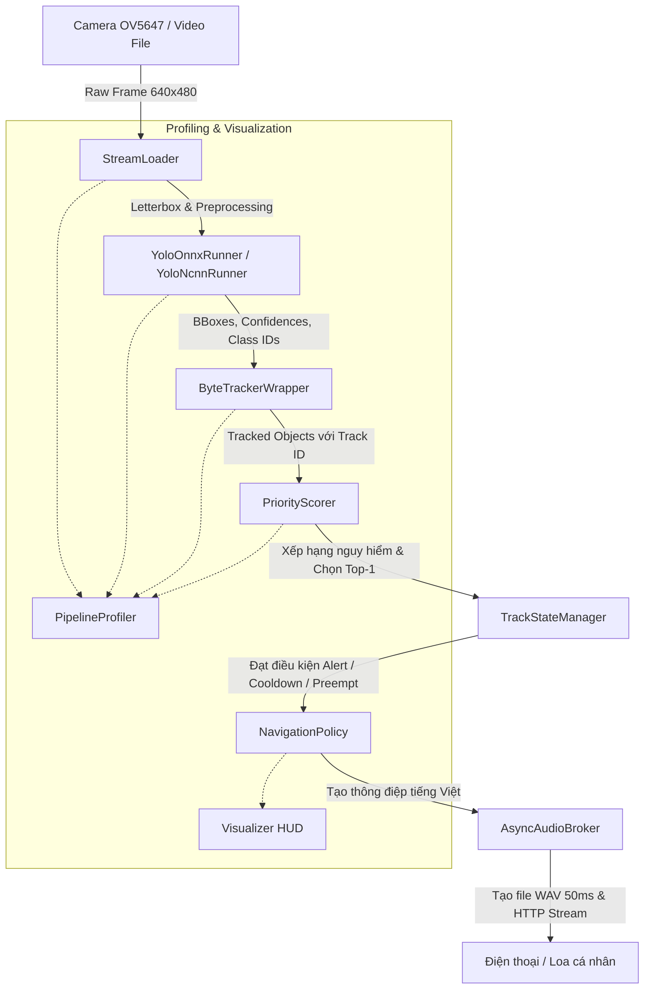

# ⚡ Module 2: Edge Device Runtime Engine
> **Hệ thống xử lý biên thời gian thực trên Raspberry Pi 4: Thị giác máy tính, Bám vết đa đối tượng, Chính sách phân làn và Phát thanh điều hướng**

[](https://www.python.org/)
[](https://onnxruntime.ai/)
[](https://github.com/ifzhang/ByteTrack)
[](https://supervision.roboflow.com/)
[](https://github.com/espeak-ng/espeak-ng)

---

## 📌 1. Giới thiệu tổng quan

Module **`2_edge_device`** là hạt nhân điều khiển của toàn bộ hệ thống hỗ trợ người khiếm thị. Được thiết kế chạy độc lập trên **Raspberry Pi 4 (4GB RAM)** với pin sạc dự phòng, module này liên tục thu nhận hình ảnh từ Camera góc rộng, nhận diện và bám vết chướng ngại vật, tính toán điểm rủi ro va chạm, đưa ra chỉ dẫn né tránh an toàn bằng tiếng Việt và phát thanh tới tai người dùng với độ trễ cực thấp (< 100ms).

Ngoài ra, thiết bị tích hợp khả năng gọi **Cloud Vision-Language Model (VLM)** qua nút bấm vật lý để mô tả chi tiết không gian khi người dùng cần định hướng tổng quan.

---

## 🔄 2. Kiến trúc luồng xử lý (Pipeline Dataflow)

Toàn bộ chu trình hoạt động của thiết bị biên được thiết kế theo mô hình xử lý đường ống liên tục (Sequential Pipeline) không nghẽn:



---

## 📂 3. Cấu trúc thư mục chi tiết

```text
2_edge_device/
├── configs/                             # File tham số cấu hình hệ thống
│   ├── default_config.yaml              # Cấu hình ngưỡng model, tracker, camera, policy
│   └── class_weights.yaml               # Bảng trọng số nguy hại cho 80 lớp COCO
│
├── core/                                # Không gian mở rộng logic lõi phần cứng (ToF/IMU)
│
├── modules/                             # Các khối chức năng độc lập (Modular Architecture)
│   ├── vision_local/                    # Nhận diện & Bám vết cục bộ (Real-time Vision)
│   │   ├── base_detector.py             # Lớp trừu tượng BaseDetector
│   │   ├── yolo_onnx_runner.py          # Bộ suy luận YOLOv8 bằng ONNX Runtime đa luồng
│   │   ├── yolo_ncnn_runner.py          # Bộ suy luận YOLOv8 bằng NCNN FP16 tối ưu ARM
│   │   ├── tracker.py                   # Bộ bám vết ByteTrackerWrapper (Supervision 0.30+)
│   │   └── models/                      # Trọng số mô hình (.onnx, .bin, .param, .pt)
│   │
│   ├── decision/                        # Bộ não quyết định & Điều hướng an toàn
│   │   ├── priority_scorer.py           # Tính điểm rủi ro kết hợp Class + Position + Size
│   │   ├── track_state_manager.py       # Quản lý Cooldown, Preemption và Auto-eviction theo Track
│   │   └── navigation_policy.py         # Phân làn 3 vùng (Trái - Giữa - Phải) & sinh lệnh tiếng Việt
│   │
│   ├── audio/                           # Bộ phát thanh âm thanh độ trễ thấp
│   │   └── audio_broker.py              # AsyncAudioBroker: HTTP server + espeak-ng + MediaSession
│   │
│   ├── vision_cloud/                    # Trợ lý ngôn ngữ thị giác đám mây (On-demand)
│   │   └── vision_cloud_runner.py       # Client gọi Qwen-VL / LLaVA / Gemini qua API
│   │
│   └── utils/                           # Các công cụ hỗ trợ
│       ├── profiler.py                  # Đo đạc latency 5 công đoạn và vẽ HUD
│       ├── stream_loader.py             # Bộ nạp frame đa năng (Webcam / Video đồng bộ FPS)
│       └── visualizer.py                # Vẽ BBox, highlight Top-1, banner cảnh báo
│
├── experiments/                         # Các kịch bản thử nghiệm độc lập
│   ├── exp_onnx_tracker_pipeline.py     # Thử nghiệm trọn vẹn pipeline ONNX + Tracker
│   ├── exp_yolo_phone_alert.py          # Thử nghiệm phát âm thanh sang điện thoại qua Web
│   ├── export_onnx.py                   # Script xuất ONNX từ file PyTorch
│   └── local_voice_server.py            # Server giọng nói độc lập
│
├── tests/                               # Bộ Unit Test tự động
│   ├── test_decision.py                 # Kiểm thử Scorer, State Manager và Policy
│   ├── test_onnx_runner.py              # Kiểm thử Output Shape và NMS của ONNX Runner
│   ├── test_pipeline_runner.py          # Kiểm thử vòng lặp PipelineRunner
│   └── test_tracker_and_profiler.py     # Kiểm thử ByteTrack và Profiler
│
├── pipeline_runner.py                   # Lớp thực thi Pipeline chuẩn Dependency Injection
└── main.py                              # Điểm khởi chạy chính thức với CLI arguments
```

---

## 🔬 4. Thuật toán & Logic cốt lõi

### 4.1. Bộ phát hiện & Bám vết (Detection & Tracking)
- **`YoloOnnxRunner`**:
  - Tiền xử lý với hàm **`letterbox`** bảo toàn tỷ lệ khung hình gốc của ảnh, tự động thêm padding màu xám `(114, 114, 114)`.
  - Tối ưu hóa phân luồng với `intra_op_num_threads=4` khai thác trọn vẹn 4 nhân của Raspberry Pi 4.
  - Hậu xử lý Vectorized: Tách nhanh $8400 \times 84$ tensor đầu ra, lọc confidence và NMS qua `cv2.dnn.NMSBoxes`.
- **`ByteTrackerWrapper`**:
  - Giải quyết bài toán mất dấu đối tượng khi người khiếm thị xoay đầu hoặc di chuyển rung lắc.
  - Sử dụng cơ chế bám vết 2 tầng (Two-stage Data Association) của ByteTrack: liên kết cả bounding box có điểm tin cậy cao lẫn thấp, loại bỏ hiện tượng nhảy Track ID liên tục.

---

### 4.2. Tính điểm ưu tiên nguy cơ (Priority Scoring Formula)
Để người dùng không bị quá tải thông tin âm thanh, hệ thống chỉ chọn duy nhất **1 vật thể nguy hiểm nhất (Top-1 Target)** trong mỗi khung hình.

Điểm ưu tiên $S \in [0.0, 1.0]$ được tính theo công thức:

$$S = w_{class} \cdot C_i + w_{pos} \cdot \left(1 - \frac{|c_{x\_obj} - c_{x\_frame}|}{c_{x\_frame}}\right) + w_{size} \cdot \left(\frac{A_{bbox}}{A_{frame}}\right)$$

Trong đó:
- $C_i \in [0.0, 1.0]$: Trọng số nguy hiểm của lớp vật thể (đọc từ `configs/class_weights.yaml`). Ví dụ: `person=1.0`, `car=1.0`, `chair=0.75`, `bottle=0.35`.
- Thành phần vị trí ($w_{pos}$): Vật thể càng nằm gần trục chính diện giữa người dùng ($|c_x - c_{x\_frame}| \to 0$) thì điểm càng tiến tới $1.0$.
- Thành phần kích thước ($w_{size}$): Tỉ lệ diện tích BBox so với diện tích toàn khung hình biểu thị khoảng cách gần/xa. BBox càng lớn tức vật thể càng gần, điểm càng cao.
- Trọng số cấu hình mặc định: $w_{class} = 0.40$, $w_{pos} = 0.35$, $w_{size} = 0.25$ (Tổng bằng $1.0$).

---

### 4.3. Quản lý trạng thái cảnh báo (TrackStateManager)
Máy trạng thái thông minh quản lý lịch sử cảnh báo cho từng `track_id` độc lập:
1. **Vật thể mới xuất hiện:** Lần đầu tiên phát hiện `track_id` $\rightarrow$ Luôn phát cảnh báo ngay lập tức.
2. **Cơ chế Chen ngang Khẩn cấp (Preemption):** Nếu điểm nguy hiểm của vật thể tăng đột biến ($\Delta priority \ge 0.25$) so với lần cảnh báo trước (ví dụ người phía trước bước nhanh tới), hệ thống phá bỏ cooldown và cảnh báo khẩn cấp ngay.
3. **Cooldown định kỳ:** Tránh lặp lại liên tục làm phiền người dùng. Cùng một vật thể chỉ được nhắc lại sau mỗi `cooldown_seconds` (mặc định 3.0s).
4. **Tự động dọn rác (Auto-eviction):** Tự động xóa các track đã biến mất quá `max_ttl` (30 giây) để tránh rò rỉ bộ nhớ RAM khi chạy liên tục nhiều giờ.

---

### 4.4. Chính sách phân làn & Điều hướng (NavigationPolicy)
Khung hình $W$ được chia thành **3 làn bằng nhau**:

$$\text{Trái: } c_x < \frac{W}{3} \quad\Big|\quad \text{Giữa: } \frac{W}{3} \le c_x < \frac{2W}{3} \quad\Big|\quad \text{Phải: } c_x \ge \frac{2W}{3}$$

Dựa trên vị trí Top-1 và sự hiện diện của các vật thể ở các làn khác, thuật toán sinh ra chỉ dẫn tự nhiên bằng tiếng Việt:

```text
                       [KHUNG HÌNH CAMERA]
      +--------------------+--------------------+--------------------+
      |    LÀN BÊN TRÁI    |    LÀN Ở GIỮA      |    LÀN BÊN PHẢI    |
      |    (cx < W/3)      |   (W/3 <= cx < 2W/3)|    (cx >= 2W/3)    |
      +--------------------+--------------------+--------------------+
      | "Cảnh báo, có ghế  | Top-1 ở giữa:      | "Cảnh báo, có người|
      |  bên trái"         | - Bên phải trống:  |  bên phải"         |
      |                    |   "Né sang phải"   |                    |
      |                    | - Bên trái trống:  |                    |
      |                    |   "Né sang trái"   |                    |
      |                    | - Cả 2 bên kẹt:    |                    |
      |                    |   "Dừng lại"       |                    |
      +--------------------+--------------------+--------------------+
```

---

### 4.5. Bộ phát âm thanh nền (AsyncAudioBroker)
Một giải pháp phần mềm độc đáo giúp biến điện thoại của người khiếm thị trong túi quần thành một **Loa thông minh không dây**:
- Thiết bị biên khởi chạy một Web Server siêu nhẹ trên cổng `8080`.
- Khi có cảnh báo mới, `espeak-ng` sinh file âm thanh WAV tiếng Việt chỉ trong **0.05 giây**.
- Giao diện Web trên điện thoại sử dụng **HTML5 Audio + MediaSession API**, cho phép phát âm thanh liên tục ngay cả khi **người dùng bấm nút nguồn khóa màn hình hoặc bỏ điện thoại vào túi**.

---

### 4.6. Trợ lý thị giác đám mây (Cloud Vision-Language Assistant)
- Tích hợp mô hình thị giác lớn (Qwen-VL, LLaVA 7B) qua giao thức OpenAI API tương thích.
- Ảnh được nén tự động về kích thước $384\text{px}$ với chất lượng JPEG 70, giảm thiểu token và đảm bảo tốc độ phản hồi đám mây dưới **2 giây**.
- Prompt định hướng chuyên biệt: đóng vai người bạn đồng hành hướng dẫn di chuyển, mô tả không gian ngắn gọn trong 1-2 câu tiếng Việt và không dùng danh sách số.

---

## ⚙️ 5. Cấu hình hệ thống (YAML Configuration)

Hệ thống được điều khiển bởi file `configs/default_config.yaml`:

```yaml
model:
  onnx_path: "modules/vision_local/models/yolov8n.onnx"
  target_size: 640        # Kích thước ảnh đầu vào (640 hoặc 320)
  conf_threshold: 0.45    # Ngưỡng tin cậy tối thiểu
  nms_threshold: 0.45     # Ngưỡng Non-Maximum Suppression
  num_threads: 4          # Số luồng CPU trên Pi 4

tracker:
  track_threshold: 0.25   # Ngưỡng kích hoạt tracklet
  track_buffer: 30        # Số frame lưu vết khi mất dấu
  match_threshold: 0.8    # Ngưỡng IoU matching

policy:
  weights:
    w_class: 0.40         # Trọng số loại vật thể
    w_position: 0.35      # Trọng số vị trí trung tâm
    w_size: 0.25          # Trọng số kích thước diện tích
  cooldown_seconds: 3.0   # Giãn cách cảnh báo lặp lại
  re_alert_delta_priority: 0.25  # Ngưỡng chen ngang khi nguy cơ tăng vọt

source:
  input: 0                # 0 cho webcam hoặc "path/to/video.mp4"
  width: 640
  height: 480
  fps: 30
```

---

## 🚀 6. Hướng dẫn sử dụng & Chạy thực thi

### 6.1. Khởi chạy cơ bản
```bash
# Di chuyển vào thư mục edge device
cd 2_edge_device

# Chạy với Webcam mặc định và hiển thị giao diện
python main.py

# Chạy với file video test có sẵn
python main.py --source /path/to/test_video.mp4
```

### 6.2. Các tùy chọn dòng lệnh (CLI Options)

| Tham số | Ý nghĩa | Ví dụ |
| :--- | :--- | :--- |
| `--source` | Nguồn video (chỉ số webcam hoặc file video) | `--source 0` hoặc `--source walk.mp4` |
| `--config` | Đường dẫn file cấu hình YAML tùy chỉnh | `--config configs/my_config.yaml` |
| `--device` | Chọn thiết bị phần cứng (`cpu` hoặc `cuda`) | `--device cpu` |
| `--conf` | Ghi đè ngưỡng confidence threshold | `--conf 0.5` |
| `--no-display` | Chạy không mở cửa sổ (Headless trên Raspberry Pi qua SSH) | `--no-display` |
| `--no-audio` | Tắt Audio Server (dùng khi debug logic thị giác) | `--no-audio` |
| `--no-lane` | Tắt overlay phân làn 3 vùng trên màn hình | `--no-lane` |
| `--profile` | In bảng thống kê chi tiết độ trễ từng frame ra console | `--profile` |
| `--cooldown` | Ghi đè thời gian cooldown cảnh báo (giây) | `--cooldown 2.5` |

### 6.3. Kịch bản thực tế trên Raspberry Pi 4 (Headless + Loa Web)
```bash
# Chạy tối ưu CPU, không hiển thị cửa sổ đồ họa, in profile định kỳ
python main.py --source 0 --device cpu --no-display --profile
```
Sau đó, từ điện thoại của người khiếm thị kết nối cùng mạng WiFi, mở trình duyệt Chrome truy cập:
`http://<IP_RASPBERRY_PI>:8080` $\rightarrow$ Nhấn **"KÍCH HOẠT LOA NỀN"** và bỏ điện thoại vào túi.

---

## 🧪 7. Chạy kiểm thử tự động (Unit Tests)

Bộ test toàn diện đảm bảo các module hoạt động chính xác trước khi tích hợp:

```bash
# Kiểm thử toàn bộ bộ não ra quyết định (Scorer, State Manager, Policy)
python tests/test_decision.py

# Kiểm thử bộ nạp mô hình ONNX và NMS
python tests/test_onnx_runner.py

# Kiểm thử bộ bám vết ByteTrack và Profiler đo thời gian
python tests/test_tracker_and_profiler.py

# Kiểm thử chu trình PipelineRunner
python tests/test_pipeline_runner.py
```
