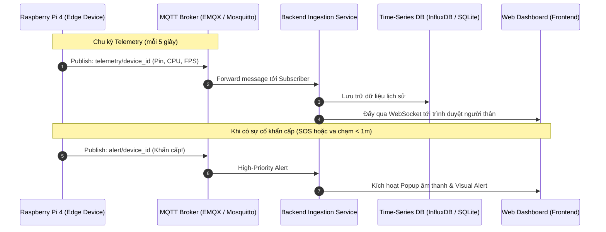

# 🌐 Module 3: Remote Caregiver Web Dashboard & Telemetry
> **Hệ thống giám sát từ xa cho người thân: Telemetry, Định vị, Cảnh báo khẩn cấp và Trạng thái thiết bị biên**

[](https://www.docker.com/)
[](https://mqtt.org/)
[](https://fastapi.tiangolo.com/)
[](https://react.dev/)

---

## 📌 1. Giới thiệu tổng quan

Module **`3_web_dashboard`** cung cấp giải pháp giám sát từ xa toàn diện dành cho người thân hoặc người bảo trợ của người khiếm thị. Thông qua giao diện web trực quan, người thân có thể:
1. **Theo dõi trạng thái sức khỏe phần cứng:** Mức pin còn lại (%), nhiệt độ CPU (°C) của Raspberry Pi, tình trạng kết nối mạng, FPS xử lý của camera.
2. **Nhận cảnh báo thời gian thực:** Đồng bộ tức thời các cảnh báo va chạm nghiêm trọng hoặc tín hiệu bấm nút khẩn cấp (SOS).
3. **Định vị & Lịch sử di chuyển:** Hiển thị tọa độ GPS (hoặc phòng trong nhà) và hành trình di chuyển của người khiếm thị.
4. **Hỗ trợ thị giác từ xa:** Xem hình ảnh chụp nhanh (snapshot) theo yêu cầu hoặc nhận bản tóm tắt mô tả cảnh quan từ Cloud VLM.

---

## 🏗 2. Kiến trúc hệ thống (System Architecture)

Dữ liệu đo xa (Telemetry) được truyền nhận theo mô hình Publish/Subscribe qua giao thức **MQTT**, đảm bảo tiêu tốn cực ít băng thông 4G/WiFi và hoạt động ổn định ngay cả khi mạng chập chờn:



---

## 📂 3. Cấu trúc thư mục

```text
3_web_dashboard/
├── backend/                     # Dịch vụ Backend nhận Telemetry & Cung cấp API
│   ├── app/
│   │   ├── api/                 # Endpoints REST (Devices, Telemetry history, Users)
│   │   ├── core/                # Cấu hình kết nối MQTT Broker & Database
│   │   ├── mqtt/                # Trình xử lý đăng ký và lắng nghe topic MQTT
│   │   ├── websockets/          # Bộ quản lý kết nối WebSocket đẩy dữ liệu lên Web
│   │   └── models/              # Schema dữ liệu (Pydantic / SQLAlchemy)
│   ├── Dockerfile               # Container hóa Backend
│   └── requirements.txt         # Thư viện: fastapi, paho-mqtt, uvicorn, websockets
│
├── frontend/                    # Giao diện Web Dashboard (Single Page App)
│   ├── src/
│   │   ├── components/          # Gauge Pin, Biểu đồ nhiệt độ CPU, Thẻ trạng thái cảm biến
│   │   ├── hooks/               # useWebSocket hook nhận dữ liệu realtime
│   │   ├── pages/               # Trang chủ Dashboard, Bản đồ, Lịch sử cảnh báo
│   │   └── styles/              # CSS hiện đại, hỗ trợ Dark Mode & Glassmorphism
│   ├── Dockerfile               # Container hóa Frontend (Nginx static build)
│   └── package.json             # React, Vite, Lucide-React, Recharts
│
└── docker-compose.yml           # Triển khai hợp nhất MQTT Broker, Backend và Frontend
```

---

## 📡 4. Giao thức truyền thông & Dữ liệu mẫu (Data Contracts)

### 4.1. Topic MQTT
Hệ thống sử dụng các topic chuẩn hóa theo định danh thiết bị (`device_id`):
- `pbl6/telemetry/{device_id}`: Gửi định kỳ trạng thái phần cứng (5s/lần).
- `pbl6/alert/{device_id}`: Gửi tức thời khi phát hiện vật cản nguy hiểm hoặc người dùng bấm nút SOS.
- `pbl6/command/{device_id}`: Người thân gửi lệnh từ web xuống Pi (ví dụ: phát tiếng bíp định vị tìm thiết bị).

### 4.2. Cấu trúc Payload Telemetry
```json
{
  "device_id": "rpi4_blind_nav_01",
  "timestamp": 1729862400,
  "battery": {
    "percentage": 82,
    "voltage": 5.12,
    "charging": false
  },
  "system": {
    "cpu_temp_c": 56.4,
    "cpu_usage_pct": 68.2,
    "ram_used_mb": 1150,
    "ram_total_mb": 3800,
    "fps": 18.5
  },
  "sensors": {
    "camera_online": true,
    "tof_online": true,
    "audio_active": true
  },
  "latest_alert": {
    "track_id": 4,
    "class_name": "person",
    "lane": "center",
    "distance_m": 1.25,
    "alert_text": "Có người phía trước, né sang phải"
  }
}
```

---

## 🖥 5. Tính năng giao diện người dùng (Dashboard Features)

- **Thẻ trạng thái tức thời (Live Status Card):**
  - Hiển thị badge kết nối Xanh (Online) / Đỏ (Offline).
  - Vòng tròn tiến trình mức pin với cảnh báo đỏ khi pin dưới 20%.
  - Gauge đo nhiệt độ CPU kèm cảnh báo quá nhiệt (> 75°C).
- **Radar phân làn ảo (Virtual Lane Radar):**
  - Mô phỏng không gian 3 làn (Trái - Giữa - Phải) thể hiện các chướng ngại vật mà thiết bị đang theo dõi thời gian thực.
- **Bảng ghi nhật ký cảnh báo (Alert Logs):**
  - Dòng thời gian ghi nhận lại tất cả các vật cản nguy hiểm đã né trong ngày, thời điểm phát sinh và thông điệp chỉ dẫn đã được phát.
- **Nút gọi khẩn cấp (Emergency SOS Alert):**
  - Khi người khiếm thị nhấn giữ nút trên thiết bị, Dashboard lập tức phát chuông báo động đỏ và hiển thị tọa độ cần hỗ trợ.

---

## 🚀 6. Hướng dẫn triển khai (Deployment Guide)

### 6.1. Triển khai toàn bộ với Docker Compose
Cách nhanh nhất và chuẩn xác nhất để khởi chạy hệ thống:

```bash
cd 3_web_dashboard

# Khởi động MQTT Broker, Backend và Frontend trong nền
docker-compose up -d --build
```

Sau khi khởi chạy thành công:
- **Web Dashboard:** `http://localhost:3000` (hoặc cổng cấu hình)
- **Backend API Docs:** `http://localhost:8000/docs`
- **MQTT Broker Dashboard (EMQX):** `http://localhost:18083` (Tài khoản mặc định: `admin`/`public`)

### 6.2. Chạy thử nghiệm môi trường phát triển (Local Development)

**Chạy Backend độc lập:**
```bash
cd 3_web_dashboard/backend
uv pip install -r requirements.txt
uvicorn app.main:app --host 0.0.0.0 --port 8000 --reload
```

**Chạy Frontend độc lập:**
```bash
cd 3_web_dashboard/frontend
npm install
npm run dev
```

---

## 🔒 7. Bảo mật & Kiểm soát truy cập

- **Xác thực thiết bị:** Mỗi Raspberry Pi sử dụng Client Certificate hoặc Token xác thực riêng biệt qua giao thức MQTTS (MQTT qua TLS/SSL).
- **Phân quyền người thân:** Tài khoản người bảo trợ được cấp quyền quản trị trên Dashboard, chỉ có thể xem dữ liệu và vị trí của thiết bị đã được ghép nối (Pairing Code).
