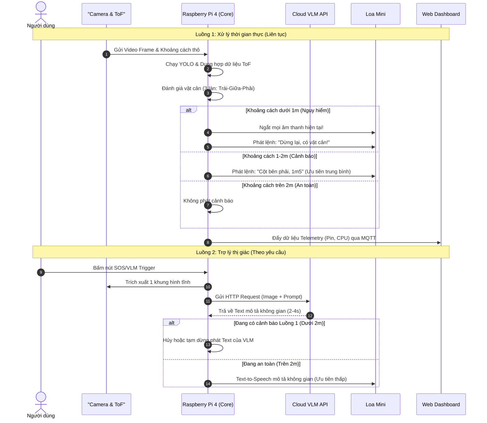

# Thiết Bị Thông Minh Hỗ Trợ Người Khiếm Thị 
*(Smart Wearable Vision-Assistance System)*

## 📖 Tổng quan dự án
Dự án phát triển một hệ thống đeo thông minh giúp người khiếm thị nhận diện vật cản và điều hướng trong môi trường trong nhà (lớp học, hành lang). Hệ thống kết hợp trí tuệ nhân tạo biên (Edge-AI) để xử lý thời gian thực và mô hình ngôn ngữ thị giác đám mây (Cloud VLM) để cung cấp nhận thức không gian theo yêu cầu.

### 🎯 Mục tiêu phần cứng
*   **Cụm thiết bị viền mũ:** Camera góc rộng OV5647 (120° FOV) và cảm biến khoảng cách siêu âm HC-SR04 (thay thế ToF, chùm nón ~30°).
*   **Hộp xử lý trung tâm (đeo balo):** Raspberry Pi 4 (4GB RAM) chạy độc lập bằng pin sạc dự phòng.
*   **Loa mini đeo vai:** Phát cảnh báo tức thời không gây bít tai.
*   **Web Dashboard:** Giám sát trạng thái phần cứng và từ xa dành cho người thân (thông qua MQTT).

## ✨ Tính năng cốt lõi
1.  **Dung hợp cảm biến đa phương thức (Mức B - Khuyến nghị):**
    *   Hợp nhất Camera YOLO và cảm biến siêu âm HC-SR04.
    *   Khoảng cách camera kết hợp mô hình hình học mặt sàn (*Ground-plane geometry*) $d_{\text{cam}} = \frac{f_y \cdot h}{v_{\text{bottom}} - c_y}$ và *Pinhole heuristic* fallback $\frac{W_{\text{real}} \cdot f_x}{\text{bbox\_width}}$.
    *   Bộ lọc Kalman theo từng track với vector trạng thái $[d, \dot{d}]$ (khoảng cách và tốc độ tiến lại).
    *   Tính toán trực tiếp thời gian đến lúc va chạm: $\text{TTC} = \frac{d}{-\dot{d}}$ tích hợp vào điểm rủi ro va chạm (*Risk Score*).
    *   Tự hiệu chỉnh thang đo trực tuyến (*Online Scale Calibration*): camera tự học thang đo $s = d_{\text{us}} / d_{\text{cam}}$ từ siêu âm để định lượng chính xác các vật ngoài chùm sóng.
    *   Quy tắc an toàn khẩn cấp (*Fail-Safe*): bất kỳ khi nào siêu âm báo cự ly $< 0.8\text{m}$ lập tức cảnh báo dừng ngay mà không cần chờ AI gắn nhãn.
    *   Xử lý triệt để 4 tình huống mâu thuẫn giữa Camera và Siêu âm.
2.  **Điều hướng phản xạ trong nhà:** Chia khung hình làm 3 làn (Trái - Giữa - Phải) để chỉ dẫn người dùng lách tránh an toàn.
3.  **Trợ lý thị giác (On-demand):** Gọi API VLM (Gemini/GPT-4V) qua nút bấm vật lý để mô tả chi tiết cảnh quan xung quanh.
4.  **Giám sát từ xa (Telemetry):** Gửi dữ liệu pin, nhiệt độ CPU, trạng thái cảm biến lên Web Dashboard.

## 🔄 Biểu đồ tuần tự (Sequence Diagram)

Dưới đây là luồng hoạt động của hệ thống, bao gồm luồng xử lý thời gian thực (Local Edge-AI) và luồng xử lý theo yêu cầu (Cloud VLM).



## 📂 Cấu trúc thư mục (Modular Architecture)

Dự án được cấu trúc theo dạng micro-module để dễ dàng thực nghiệm (benchmark) và triển khai:

```text
blind_nav_project/
├── 1_model_development/         # Không gian huấn luyện & nén mô hình
│   ├── datasets/                # Dữ liệu ảnh COCO, Roboflow (Cửa, Bình cứu hỏa...)
│   ├── notebooks/               # Phân tích dữ liệu EDA
│   ├── scripts/                 # Script train, fine-tune và compress (Quantization, Export)
│   └── weights/                 # Nơi lưu model đã tối ưu (NCNN, TFLite)
│
├── 2_edge_device/               # Mã nguồn triển khai trên Raspberry Pi 4
│   ├── configs/                 # File cấu hình (YAML) cho model và MQTT
│   ├── core/                    # Logic dung hợp ToF + Bounding Box & Điều hướng
│   ├── modules/
│   │   ├── sensors/             # camera_ov5647.py, tof_vl53l1x.py
│   │   ├── vision_local/        # base_detector.py, yolo_ncnn_runner.py
│   │   ├── vision_cloud/        # Gọi API Trợ lý VLM (Gemini/GPT-4V)
│   │   ├── audio_tts/           # Bộ quản lý ưu tiên âm thanh (pyttsx3)
│   │   └── telemetry/           # Client gửi dữ liệu MQTT
│   ├── experiments/             # Script benchmark FPS, RAM, Nhiệt độ
│   └── main.py                  # Điểm khởi chạy thiết bị biên
│
└── 3_web_dashboard/             # Giao diện giám sát cho người thân
    ├── backend/                 # Node.js/FastAPI nhận MQTT
    ├── frontend/                # React/Vue hiển thị thông số pin, cảm biến
    └── docker-compose.yml       # Cấu hình container cho DB, Broker, Backend, Frontend
```

## 🛠 Hướng dẫn cài đặt môi trường (uv & Python 3.10)

Chúng tôi sử dụng `uv` (một trình quản lý gói và môi trường Python cực nhanh viết bằng Rust) để đảm bảo tốc độ cài đặt và tính nhất quán trên Raspberry Pi cũng như PC.

### Bước 1: Cài đặt `uv`
Mở terminal và chạy lệnh sau (hỗ trợ Linux/macOS/Raspberry Pi OS):
```bash
curl -LsSf https://astral.sh/uv/install.sh | sh
```
*(Đối với Windows, sử dụng PowerShell: `powershell -c "irm https://astral.sh/uv/install.ps1 | iex"`)*

### Bước 2: Khởi tạo dự án và môi trường Python 3.10
Di chuyển vào thư mục dự án và tạo môi trường ảo với đích danh Python 3.10:
```bash
# Tạo thư mục dự án
mkdir blind_nav_system && cd blind_nav_system

# Khởi tạo môi trường ảo bằng uv
uv venv --python 3.10
```

### Bước 3: Kích hoạt môi trường
*   **Linux/macOS/Raspberry Pi:**
    ```bash
    source .venv/bin/activate
    ```
*   **Windows:**
    ```bash
    .venv\Scripts\activate
    ```

### Bước 4: Cài đặt các thư viện phụ thuộc
Bạn có thể cài đặt trực tiếp các gói cần thiết thông qua `uv pip` (nhanh hơn rất nhiều so với pip truyền thống):

```bash
# Các thư viện lõi cho AI và Cảm biến
uv pip install opencv-python-headless numpy pyyaml

# Thư viện cho phần cứng (chỉ chạy trên Raspberry Pi)
uv pip install smbus2 VL53L1X RPi.GPIO

# Thư viện cho Âm thanh và Giao tiếp
uv pip install pyttsx3 paho-mqtt requests
```

*(Tùy chọn) Nếu bạn có file `requirements.txt`, bạn có thể cài đặt đồng loạt bằng:*
```bash
uv pip install -r requirements.txt
```

## 🚀 Hướng dẫn chạy thử nghiệm

### 1. Chạy bộ kiểm thử mô phỏng toàn diện (Fusion Mức B):
```bash
python 2_edge_device/experiments/test_fusion_simulation.py
```

### 2. Chạy ứng dụng điều hướng thực tế trên Edge Device:
```bash
cd 2_edge_device
python main.py
```