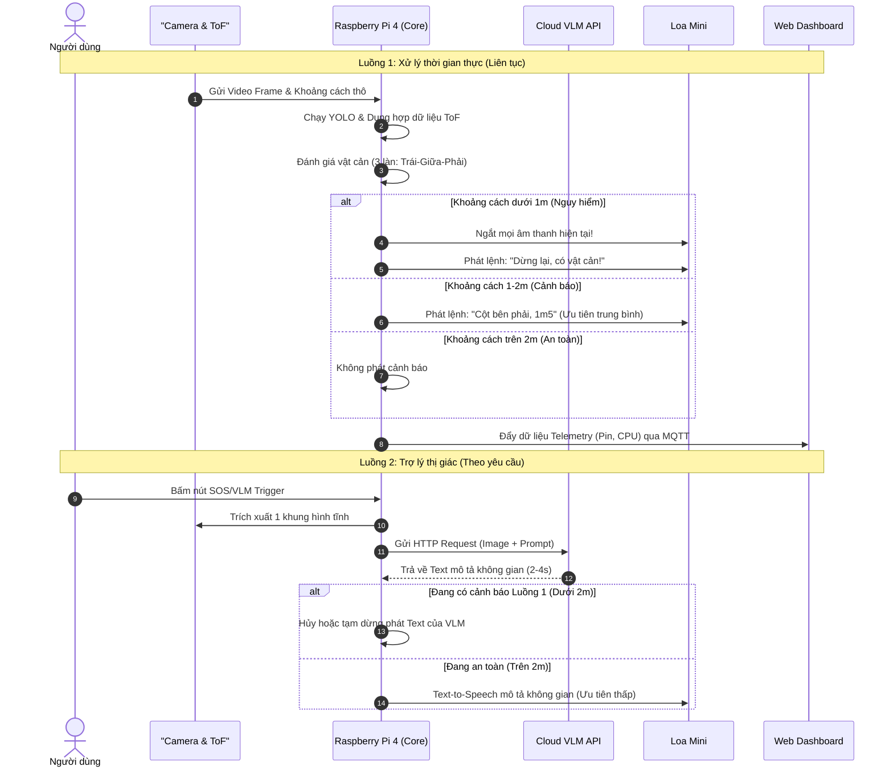

# Thiết Bị Thông Minh Hỗ Trợ Người Khiếm Thị 
*(Smart Wearable Vision-Assistance System)*

## 📖 Tổng quan dự án
Dự án phát triển một hệ thống đeo thông minh giúp người khiếm thị nhận diện vật cản và điều hướng trong môi trường trong nhà (lớp học, hành lang). Hệ thống kết hợp trí tuệ nhân tạo biên (Edge-AI) để xử lý thời gian thực và mô hình ngôn ngữ thị giác đám mây (Cloud VLM) để cung cấp nhận thức không gian theo yêu cầu.

### 🎯 Mục tiêu phần cứng
*   **Cụm thiết bị viền mũ:** Camera góc rộng OV5647 (120° FOV) và cảm biến khoảng cách ToF VL53L1X.
*   **Hộp xử lý trung tâm (đeo balo):** Raspberry Pi 4 (4GB RAM) chạy độc lập bằng pin sạc dự phòng.
*   **Loa mini đeo vai:** Phát cảnh báo tức thời không gây bít tai.
*   **Web Dashboard:** Giám sát trạng thái phần cứng và từ xa dành cho người thân (thông qua MQTT).

## ✨ Tính năng cốt lõi
1.  **Cảnh báo va chạm tức thời:** YOLO kết hợp ToF phát hiện vật cản tầng ngực - đầu. Cảnh báo dừng khẩn cấp (< 1m) và đọc phương hướng/cự ly (1-2m).
2.  **Điều hướng phản xạ trong nhà:** Chia khung hình làm 3 làn (Trái - Giữa - Phải) để chỉ dẫn người dùng lách tránh an toàn.
3.  **Trợ lý thị giác (On-demand):** Gọi API VLM (Gemini/GPT-4V) qua nút bấm vật lý để mô tả chi tiết cảnh quan xung quanh.
4.  **Giám sát từ xa (Telemetry):** Gửi dữ liệu pin, nhiệt độ CPU, trạng thái cảm biến lên Web Dashboard.

## 🔄 Biểu đồ tuần tự (Sequence Diagram)

Dưới đây là luồng hoạt động của hệ thống, bao gồm luồng xử lý thời gian thực (Local Edge-AI) và luồng xử lý theo yêu cầu (Cloud VLM).



## 📂 Cấu trúc thư mục (Modular Architecture)

Dự án được cấu trúc theo dạng micro-module để dễ dàng thực nghiệm (benchmark) và triển khai:

```text
blind_nav_project/
├── 1_model_development/         # Không gian huấn luyện & nén mô hình
│   ├── datasets/                # Dữ liệu ảnh COCO, Roboflow (Cửa, Bình cứu hỏa...)
│   ├── notebooks/               # Phân tích dữ liệu EDA
│   ├── scripts/                 # Script train, fine-tune và compress (Quantization, Export)
│   └── weights/                 # Nơi lưu model đã tối ưu (NCNN, TFLite)
│
├── 2_edge_device/               # Mã nguồn triển khai trên Raspberry Pi 4
│   ├── configs/                 # File cấu hình (YAML) cho model và MQTT
│   ├── core/                    # Logic dung hợp ToF + Bounding Box & Điều hướng
│   ├── modules/
│   │   ├── sensors/             # camera_ov5647.py, tof_vl53l1x.py
│   │   ├── vision_local/        # base_detector.py, yolo_ncnn_runner.py
│   │   ├── vision_cloud/        # Gọi API Trợ lý VLM (Gemini/GPT-4V)
│   │   ├── audio_tts/           # Bộ quản lý ưu tiên âm thanh (pyttsx3)
│   │   └── telemetry/           # Client gửi dữ liệu MQTT
│   ├── experiments/             # Script benchmark FPS, RAM, Nhiệt độ
│   └── main.py                  # Điểm khởi chạy thiết bị biên
│
└── 3_web_dashboard/             # Giao diện giám sát cho người thân
    ├── backend/                 # Node.js/FastAPI nhận MQTT
    ├── frontend/                # React/Vue hiển thị thông số pin, cảm biến
    └── docker-compose.yml       # Cấu hình container cho DB, Broker, Backend, Frontend
```

## 🛠 Hướng dẫn cài đặt môi trường (uv & Python 3.10)

Chúng tôi sử dụng `uv` (một trình quản lý gói và môi trường Python cực nhanh viết bằng Rust) để đảm bảo tốc độ cài đặt và tính nhất quán trên Raspberry Pi cũng như PC.

### Bước 1: Cài đặt `uv`
Mở terminal và chạy lệnh sau (hỗ trợ Linux/macOS/Raspberry Pi OS):
```bash
curl -LsSf https://astral.sh/uv/install.sh | sh
```
*(Đối với Windows, sử dụng PowerShell: `powershell -c "irm https://astral.sh/uv/install.ps1 | iex"`)*

### Bước 2: Khởi tạo dự án và môi trường Python 3.10
Di chuyển vào thư mục dự án và tạo môi trường ảo với đích danh Python 3.10:
```bash
# Tạo thư mục dự án
mkdir blind_nav_system && cd blind_nav_system

# Khởi tạo môi trường ảo bằng uv
uv venv --python 3.10
```

### Bước 3: Kích hoạt môi trường
*   **Linux/macOS/Raspberry Pi:**
    ```bash
    source .venv/bin/activate
    ```
*   **Windows:**
    ```bash
    .venv\Scripts\activate
    ```

### Bước 4: Cài đặt các thư viện phụ thuộc
Bạn có thể cài đặt trực tiếp các gói cần thiết thông qua `uv pip` (nhanh hơn rất nhiều so với pip truyền thống):

```bash
# Các thư viện lõi cho AI và Cảm biến
uv pip install opencv-python-headless numpy pyyaml

# Thư viện cho phần cứng (chỉ chạy trên Raspberry Pi)
uv pip install smbus2 VL53L1X RPi.GPIO

# Thư viện cho Âm thanh và Giao tiếp
uv pip install pyttsx3 paho-mqtt requests
```

*(Tùy chọn) Nếu bạn có file `requirements.txt`, bạn có thể cài đặt đồng loạt bằng:*
```bash
uv pip install -r requirements.txt
```

## 🚀 Hướng dẫn chạy thử nghiệm
1. Cấu hình các API Key và thông số model trong thư mục `configs/`.
2. Chạy file chính để khởi động luồng hệ thống:
```bash
python main.py
```

## Baseline tối thiểu cho Raspberry Pi 4B

Baseline hiện chạy một main loop tuần tự cho webcam/YOLO, một thread đọc VL53L1X
và một audio queue riêng. Không dùng tracking, TTC, risk score, fine-tuning,
quantization, NCNN hoặc VLM trong luồng baseline.

### Cài đặt và khởi chạy

Trên Raspberry Pi OS 64-bit, cài thư viện hệ thống cần cho driver I2C/âm thanh
(bao gồm `espeak-ng` cho pyttsx3), bật I2C, kết nối VL53L1X ở địa chỉ `0x29`,
sau đó cài các phụ thuộc Python:

```bash
cd 2_edge_device
python3 -m venv .venv
source .venv/bin/activate
pip install -r requirements.txt
python main.py --model modules/vision_local/models/yolov8n.onnx
```

Đặt model COCO YOLOv8n ONNX tại đường dẫn trên hoặc truyền đường dẫn khác bằng
`--model`. Khi ONNX Runtime/model lỗi lúc khởi động hoặc inference lỗi, hệ thống
ghi log lỗi và tiếp tục dùng ToF để phát cảnh báo fail-safe. Nếu VL53L1X không
khởi động được, chương trình ghi WARNING và vẫn chạy camera/YOLO ở chế độ
vision-only để phục vụ phát triển/kiểm tra. Trong chế độ này không có đo khoảng
cách hoặc cảnh báo va chạm; không dùng thiết bị để điều hướng an toàn cho đến
khi ToF hoạt động. Log trạng thái sẽ ghi `tof=unavailable (vision-only)`.

ROI ToF mặc định là 40%-60% chiều rộng khung hình (`--roi-left`, `--roi-right`).
Chỉnh hai giá trị này sau khi cố định camera và ToF cùng hướng; mỗi lần đo chỉ
được ghép với một detection trung tâm gần trục ảnh nhất. Detection trái/phải
luôn có `distance_m=None`. Các mức khoảng cách là Critical `<0.5 m`, High
`0.5-<0.8 m`, Moderate `0.8-<1.2 m`, Low `1.2-1.5 m`, Clear `>1.5 m`.
Mỗi lần xử lý chỉ chọn tối đa một alert; cùng loại có cooldown mặc định 3.5 giây,
nhưng cảnh báo được phép phát ngay khi mức nguy hiểm tăng.

### Kiểm thử và xác nhận phần cứng

Chạy unit tests mô phỏng từ thư mục `2_edge_device`:

```bash
python -m unittest discover -s tests -v
```

Để chạy soak test một giờ và lưu log:

```bash
python main.py --duration 3600 2>&1 | tee baseline-soak.log
```

Trên thiết bị thực, kiểm tra lần lượt năm tình huống: (1) người ở giữa, (2) ghế
ở giữa, (3) vật thể bên trái/phải không nhận khoảng cách ToF, (4) vật cản ngoài
khả năng nhận dạng YOLO nhưng ToF gần vẫn phát “Vật cản phía trước”, và (5)
YOLO lỗi nhưng ToF vẫn phát cảnh báo. Kiểm tra log FPS, preprocessing,
inference, postprocessing, sensor-to-alert latency, CPU, RAM, nhiệt độ, khoảng
cách, detection được chọn và alert. Unit tests không thay thế việc kiểm tra một
giờ và demo phần cứng thực tế.

Trước khi baseline được đóng băng, lưu hash model (`sha256sum`), cấu hình ROI/
threshold/cooldown, log benchmark trên Pi và Git commit cụ thể. Chỉ sau bước
đóng băng đó mới phát triển các tính năng risk-aware trên nhánh riêng.