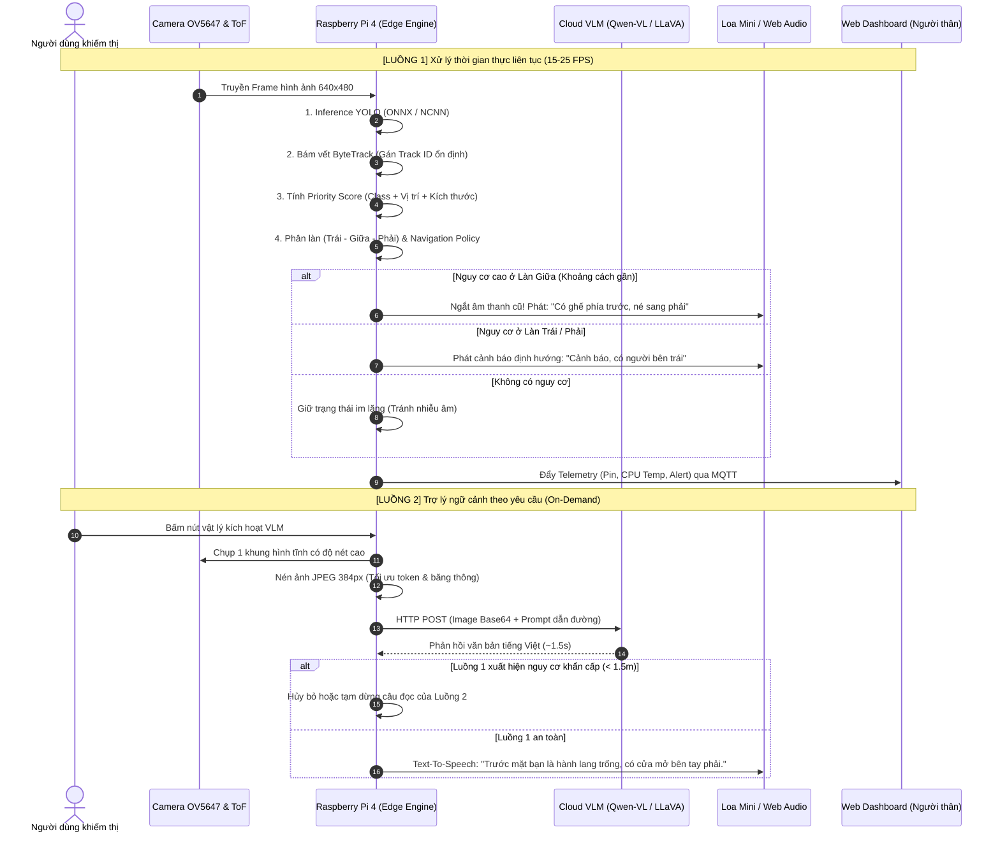

# 🦯 PBL6: Thiết Bị Thông Minh Hỗ Trợ Người Khiếm Thị
### *Smart Wearable Vision-Assistance & Navigation System for the Visually Impaired*

[](https://www.python.org/)
[](https://astral.sh/uv)
[](https://onnxruntime.ai/)
[](https://github.com/ifzhang/ByteTrack)
[](https://opensource.org/licenses/MIT)

---

## 📖 1. Tổng quan dự án

Dự án **PBL6 - Thiết Bị Thông Minh Hỗ Trợ Người Khiếm Thị** nghiên cứu và phát triển một hệ thống thiết bị đeo (wearable) thông minh giúp người khiếm thị định hướng, phát hiện và né tránh vật cản an toàn trong môi trường trong nhà (lớp học, hành lang, phòng làm việc) và không gian đô thị.

Hệ thống kết hợp mô hình xử lý phân tầng độc đáo:
1. **Trí tuệ nhân tạo biên thời gian thực (Local Edge-AI):** Chạy trực tiếp trên vi xử lý nhúng **Raspberry Pi 4**, phát hiện và bám vết đa đối tượng liên tục ở tốc độ $15 - 25\text{ FPS}$, tính toán nguy cơ va chạm và hướng dẫn né tránh bằng âm thanh tức thì (< 100ms).
2. **Trợ lý ngôn ngữ thị giác đám mây (Cloud Vision-Language Model - VLM):** Kích hoạt theo yêu cầu thông qua nút bấm vật lý (On-demand), trích xuất khung hình và gọi các mô hình VLM tiên tiến (Qwen2-VL, LLaVA, Gemini 1.5) để mô tả chi tiết cảnh quan và lối đi an toàn trong 1-2 câu tiếng Việt tự nhiên.
3. **Cổng giám sát từ xa (Remote Telemetry & Web Dashboard):** Truyền tải thông số pin, nhiệt độ phần cứng, vị trí và lịch sử cảnh báo lên Dashboard cho người thân giám sát qua giao thức MQTT.

---

## 🎯 2. Kiến trúc phần cứng (Hardware Specifications)

Thiết bị được thiết kế theo dạng công thái học (ergonomic wearable), phân tán trọng lượng hợp lý để người dùng có thể sử dụng liên tục nhiều giờ:

| Cụm phần cứng | Thành phần linh kiện | Chức năng kỹ thuật |
| :--- | :--- | :--- |
| **Cụm viền mũ / Kính đeo** | • Camera góc rộng **OV5647 (120° FOV)**<br>• Cảm biến khoảng cách laser **ToF VL53L1X** | • Thu nhận trường nhìn rộng bao quát cả 3 làn di chuyển.<br>• Đo khoảng cách trực tiếp tầm ngực - đầu (chính xác đến 4 mét). |
| **Hộp xử lý trung tâm (Đeo thắt lưng / Balo)** | • **Raspberry Pi 4 Model B (4GB RAM)**<br>• Vỏ nhôm tản nhiệt chủ động + quạt 5V<br>• Pin sạc dự phòng chuẩn PD (5V/3A) | • Thực thi toàn bộ chu trình AI biên, ByteTrack và máy trạng thái ra quyết định.<br>• Đảm bảo hoạt động độc lập từ 4-6 giờ liên tục. |
| **Giao diện âm thanh người dùng** | • Loa mini gắn vai áo / Tai nghe truyền xương (Bone-conduction)<br>• Hoặc kết nối trực tiếp điện thoại cá nhân | • Cung cấp âm thanh định hướng mà **không bịt kín tai**, giúp người dùng duy trì khả năng lắng nghe âm thanh môi trường xung quanh. |
| **Giao tiếp & Nút bấm** | • Nút bấm vật lý gắn ngực áo (SOS / VLM trigger)<br>• Module 4G LTE / WiFi | • Bấm 1 chạm: Gọi mô tả cảnh quan Cloud VLM.<br>• Nhấn giữ 3 giây: Báo động khẩn cấp SOS tới người thân. |

---

## 🔄 3. Kiến trúc luồng dữ liệu (Dual-Tier Sequence Diagram)

Sơ đồ trình bày cơ chế phân tầng giữa **Luồng 1 (Phản xạ né tránh biên)** và **Luồng 2 (Nhận thức ngữ cảnh đám mây)**:



---

## 📂 4. Cấu trúc thư mục dự án (Modular Architecture)

Dự án được phân chia thành **3 module chuyên biệt** với tài liệu kỹ thuật chi tiết riêng cho từng phần:

```text
pbl6-blind-navigation/
│
├── 📁 1_model_development/      # [MODULE 1] Nghiên cứu, huấn luyện & nén mô hình
│   ├── datasets/                # Dữ liệu ảnh COCO, Roboflow indoor hazards
│   ├── notebooks/               # Phân tích EDA và thực nghiệm so sánh mAP
│   ├── scripts/                 # Kịch bản train, validate, export ONNX & chuyển đổi NCNN
│   ├── weights/                 # Trọng số mô hình (yolov8n.pt, .onnx, .bin, .param)
│   └── 📄 README.md             # ➡️ Hướng dẫn chi tiết Module 1
│
├── 📁 2_edge_device/            # [MODULE 2] Phần mềm vận hành thời gian thực trên Raspberry Pi 4
│   ├── configs/                 # File cấu hình YAML (default_config.yaml, class_weights.yaml)
│   ├── modules/                 # Các khối vi xử lý độc lập
│   │   ├── vision_local/        # YoloOnnxRunner, YoloNcnnRunner, ByteTrackerWrapper
│   │   ├── decision/            # PriorityScorer, TrackStateManager, NavigationPolicy
│   │   ├── audio/               # AsyncAudioBroker (Phát thanh nền qua Web/espeak-ng)
│   │   ├── vision_cloud/        # Client giao tiếp Cloud VLM (Qwen-VL / LLaVA)
│   │   └── utils/               # PipelineProfiler, StreamLoader, Visualizer
│   ├── experiments/             # Script thực nghiệm benchmark FPS, RAM, Web Voice
│   ├── tests/                   # Bộ Unit Tests tự động (Decision, ONNX, Tracker, Pipeline)
│   ├── pipeline_runner.py       # Vòng lặp Pipeline chuẩn Dependency Injection
│   ├── main.py                  # Điểm khởi chạy thiết bị biên qua CLI
│   └── 📄 README.md             # ➡️ Hướng dẫn chi tiết Module 2
│
├── 📁 3_web_dashboard/          # [MODULE 3] Giao diện giám sát từ xa cho người thân
│   ├── backend/                 # API Server xử lý MQTT, WebSocket & cơ sở dữ liệu
│   ├── frontend/                # Giao diện web hiển thị pin, nhiệt độ, radar phân làn ảo
│   ├── docker-compose.yml       # Khởi chạy một chạm MQTT Broker, Backend và Frontend
│   └── 📄 README.md             # ➡️ Hướng dẫn chi tiết Module 3
│
├── pyproject.toml               # Quản lý dependencies dự án với uv
└── README.md                    # Tài liệu tổng quan hệ thống (File này)
```

---

## 🧠 5. Các thuật toán & Nguyên lý cốt lõi

### 5.1. Công thức tính điểm ưu tiên rủi ro (Priority Scoring)
Để hạn chế việc phát cảnh báo tràn lan gây mệt mỏi thính giác, hệ thống chấm điểm nguy hiểm cho toàn bộ các vật thể trong khung hình và chỉ tập trung vào **Top-1 Target**:

$$S = w_{class} \cdot C_i + w_{pos} \cdot \left(1 - \frac{|c_{x\_obj} - c_{x\_frame}|}{c_{x\_frame}}\right) + w_{size} \cdot \left(\frac{A_{bbox}}{A_{frame}}\right)$$

- **$C_i \in [0.0, 1.0]$:** Hệ số nguy hại của nhãn vật thể (quy định tại `class_weights.yaml`). Ví dụ: người/xe cộ $= 1.0$, bàn ghế $= 0.75-0.8$, chai lọ $= 0.35$.
- **Thành phần vị trí ($w_{pos}$):** Vật thể càng nằm ngay tim đường đi ($c_x \to c_{x\_frame}$), điểm càng cao.
- **Thành phần kích thước ($w_{size}$):** Bounding box càng to tức vật thể càng ở cự ly gần người dùng.
- Trọng số tối ưu hóa: $w_{class} = 0.40, w_{pos} = 0.35, w_{size} = 0.25$.

---

### 5.2. Máy trạng thái quản lý cảnh báo (TrackStateManager)
- **Vật thể mới:** Track ID lần đầu xuất hiện $\rightarrow$ Cảnh báo ngay lập tức.
- **Cơ chế Chen ngang Khẩn cấp (Preemption):** Nếu một vật thể đang tiếp cận rất nhanh ($\Delta priority \ge 0.25$), hệ thống bỏ qua cooldown và phát cảnh báo mới ngay.
- **Cooldown riêng biệt:** Mỗi vật thể chỉ được nhắc lại sau chu kỳ cooldown $3.0\text{ giây}$.
- **Tự dọn dẹp bộ nhớ (Auto-eviction):** Tự động giải phóng các track đã rời khỏi tầm nhìn sau $30\text{ giây}$ (TTL).

---

### 5.3. Chiến lược phân làn & Lựa chọn hướng né (Navigation Policy)
Khung hình được phân bổ làm **3 làn không gian bằng nhau**:
- **Làn Trái ($c_x < \frac{W}{3}$):** Cảnh báo định hướng: *"Cảnh báo, có vật cản bên trái"*.
- **Làn Phải ($c_x \ge \frac{2W}{3}$):** Cảnh báo định hướng: *"Cảnh báo, có vật cản bên phải"*.
- **Làn Giữa ($\frac{W}{3} \le c_x < \frac{2W}{3}$):** Là làn va chạm trực diện. Hệ thống kiểm tra hai làn còn lại:
  - Nếu Làn Phải trống $\rightarrow$ *"Có [tên vật cản] phía trước, né sang phải"*.
  - Nếu Làn Trái trống $\rightarrow$ *"Có [tên vật cản] phía trước, né sang trái"*.
  - Nếu cả hai làn đều có vật cản $\rightarrow$ *"Dừng lại, có [tên vật cản] chắn phía trước"*.

---

### 5.4. Giải pháp âm thanh nền không dây (AsyncAudioBroker)
- Khởi tạo một máy chủ HTTP cục bộ trên cổng `8080`.
- Mỗi thông điệp cảnh báo được tổng hợp thành file WAV bằng công nghệ `espeak-ng` tiếng Việt chỉ mất **$0.05\text{ giây}$**.
- Ứng dụng web trên điện thoại của người khiếm thị sử dụng chuẩn **HTML5 Audio + MediaSession API**, cho phép phát âm thanh cảnh báo to rõ ngay cả khi **điện thoại đã khóa màn hình hoặc đang cất trong túi quần**.

---

## 📊 6. Kết quả đánh giá hiệu năng (Edge Benchmark)

Thực nghiệm đo đạc thực tế trên **Raspberry Pi 4 Model B (4GB RAM)**:

| Công đoạn xử lý | Module đảm nhận | Thời gian xử lý trung bình |
| :--- | :--- | :---: |
| **1. Đọc khung hình (Capture)** | `StreamLoader` (Camera OV5647 $640 \times 480$) | $3.5\text{ ms}$ |
| **2. Suy luận AI (Inference)** | `YoloNcnnRunner` ($320 \times 320$, FP16 SIMD NEON) | **$58.2\text{ ms}$** |
| *(Tùy chọn ONNX Runtime)* | `YoloOnnxRunner` ($640 \times 640$, CPU 4 luồng) | $235.0\text{ ms}$ |
| **3. Bám vết (Tracking)** | `ByteTrackerWrapper` | $4.8\text{ ms}$ |
| **4. Ra quyết định (Policy)** | `PriorityScorer` + `TrackStateManager` | $0.8\text{ ms}$ |
| **5. Hiển thị / Debug (Render)** | `Visualizer` (Vẽ BBox, HUD, Banner) | $2.6\text{ ms}$ |
| **Tổng chu trình Pipeline (NCNN)** | **Pipeline toàn diện** | **$\approx 69.9\text{ ms}$ (~14.5 - 17.0 FPS)** |

---

## 🛠 7. Hướng dẫn cài đặt môi trường (uv & Python 3.10)

Dự án sử dụng trình quản lý gói **`uv`** (siêu tốc, viết bằng Rust) giúp việc thiết lập môi trường trên Linux PC và Raspberry Pi OS diễn ra chỉ trong vài giây.

### Bước 1: Cài đặt `uv`
```bash
curl -LsSf https://astral.sh/uv/install.sh | sh
source $HOME/.local/bin/env
```

### Bước 2: Khởi tạo môi trường ảo Python 3.10
```bash
cd pbl6-blind-navigation
uv venv --python 3.10
source .venv/bin/activate
```

### Bước 3: Cài đặt các gói thư viện
```bash
# Cài đặt các gói phụ thuộc lõi
uv pip install opencv-python-headless numpy pyyaml onnxruntime supervision trackers

# Cài đặt thư viện giọng nói espeak-ng của hệ điều hành
sudo apt update && sudo apt install -y espeak-ng
```

---

## 🚀 8. Hướng dẫn chạy thử nghiệm nhanh (Quickstart)

### 8.1. Chạy với Webcam máy tính
```bash
cd 2_edge_device
python main.py
```

### 8.2. Chạy với file video có sẵn (Offline Testing)
```bash
python main.py --source /path/to/test_video.mp4
```

### 8.3. Chạy tối ưu không màn hình trên Raspberry Pi qua SSH
```bash
python main.py --source 0 --no-display --profile
```

### 8.4. Kích hoạt Loa thông minh trên điện thoại
1. Đảm bảo điện thoại và Raspberry Pi cùng kết nối một mạng WiFi.
2. Mở trình duyệt Chrome trên điện thoại truy cập: `http://<IP_CỦA_PI>:8080`.
3. Bấm nút **"KÍCH HOẠT LOA NỀN"**, sau đó bạn có thể khóa màn hình và bỏ điện thoại vào túi.

---

## 🧪 9. Kiểm thử tự động (Automated Tests)

Thực thi bộ unit test kiểm tra toàn bộ các khối chức năng:

```bash
cd 2_edge_device
python tests/test_decision.py
python tests/test_onnx_runner.py
python tests/test_tracker_and_profiler.py
python tests/test_pipeline_runner.py
```

---

## 👥 10. Đóng góp & Phát triển

Dự án được xây dựng trong khuôn khổ đồ án PBL6. Mọi đóng góp, báo lỗi hoặc đề xuất cải tiến vui lòng mở **Issue** hoặc gửi **Pull Request**.

- **Giấy phép:** [MIT License](LICENSE)
- **Tác giả:** Đội ngũ phát triển PBL6 Blind Navigation