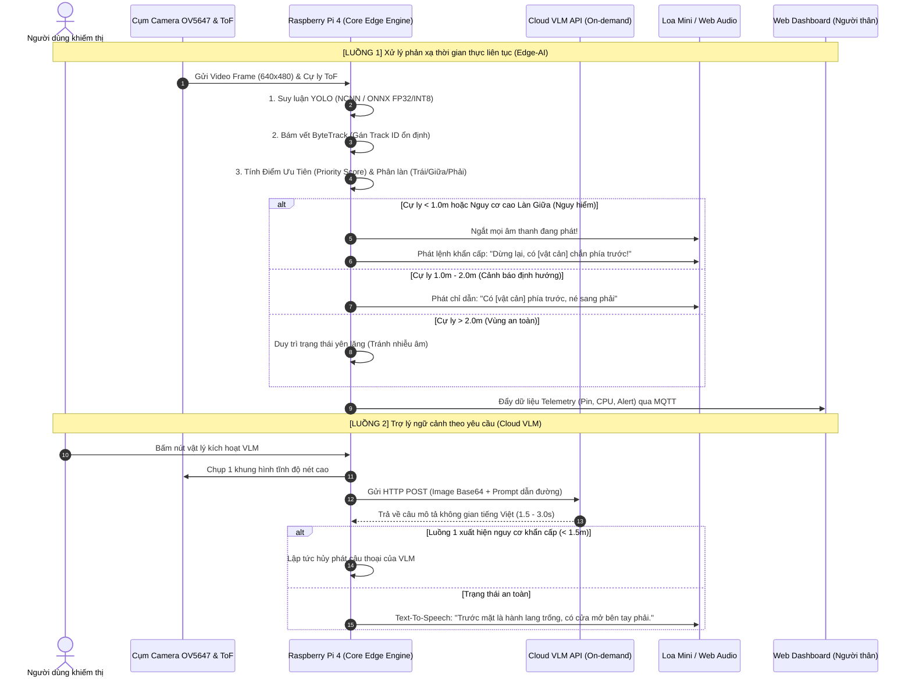

# 🦯 PBL6: Thiết Bị Thông Minh Hỗ Trợ Người Khiếm Thị
### *(Smart Wearable Vision-Assistance & Navigation System)*

[](https://www.python.org/)
[](https://astral.sh/uv)
[](https://onnxruntime.ai/)
[-green.svg)](https://huggingface.co/datasets/Abtinzandi/Obstacle-Detection-Dataset-YOLO)
[]()

---

## 📖 1. Tổng quan dự án

Dự án **Thiết Bị Thông Minh Hỗ Trợ Người Khiếm Thị** (thuộc học phần Đồ án Chuyên ngành PBL6) tập trung nghiên cứu, thiết kế và phát triển một hệ thống thiết bị đeo (wearable) trợ thị thông minh. Hệ thống hỗ trợ người khiếm thị nhận diện sớm các chướng ngại vật tiềm ẩn nguy cơ va chạm trong môi trường thực tế (vỉa hè, hành lang, phòng học, không gian đô thị) và đưa ra chỉ dẫn định hướng di chuyển an toàn, kịp thời.

Hệ thống được thiết kế theo cấu trúc **xử lý phân tầng kép (Dual-Tier)**:
1. **Tầng phản xạ tức thời tại biên (Local Edge-AI):** Chạy trực tiếp trên thiết bị vi xử lý nhúng (Raspberry Pi 4), thực hiện thu nhận video thời gian thực, phát hiện vật thể qua mô hình YOLO tối ưu hóa (NCNN/ONNX FP32 & INT8), bám vết đa đối tượng (ByteTrack), tính điểm rủi ro va chạm và chỉ dẫn né tránh an toàn qua âm thanh tức thời (< 100ms).
2. **Tầng nhận thức không gian ngữ cảnh (Cloud VLM Assistant):** Kích hoạt theo nhu cầu người dùng (On-demand) thông qua nút bấm vật lý, trích xuất khung hình độ nét cao và gửi tới mô hình thị giác - ngôn ngữ đám mây (Gemini 1.5, Qwen2-VL, LLaVA) để nhận phản hồi mô tả cảnh quan tự nhiên bằng tiếng Việt.
3. **Tầng giám sát từ xa (Remote Telemetry & Caregiver Dashboard):** Truyền tải thông số trạng thái phần cứng (pin, nhiệt độ CPU, cảnh báo va chạm, radar phân làn) về giao diện giám sát cho người thân thông qua giao thức MQTT/WebSocket.

---

## 🔄 2. Sơ đồ tuần tự hệ thống (Sequence Diagram)



---

## 🌿 3. Hiện trạng mã nguồn & Kiến trúc phân nhánh Git (Git Branch Architecture)

Thư mục `blind-navigation/` là một Git Repository độc lập quản lý mã nguồn cốt lõi của dự án. Hệ thống được phát triển song song trên các nhánh chuyên trách (feature branches):

| Nhánh Git (Branch) | Phân hệ đảm nhiệm | Hiện trạng triển khai | Nội dung chính |
| :--- | :--- | :---: | :--- |
| **`feat/model-development`**<br>*(Nhánh hiện tại)* | **Module 1: Model Development** | **✅ Hoàn thành trọn vẹn** | • Xử lý & làm sạch bộ dữ liệu **ROD-Dataset** 25 lớp (`rod_clean_v1`).<br>• Khóa kết quả độ chính xác tham chiếu 4 model: **YOLOv8n, YOLOv9t, YOLOv12n, YOLOv26n** (mAP50 > 90%).<br>• Xuất ONNX FP32 (320x320) & xác thực tương đương PyTorch.<br>• Chuyển đổi NCNN FP32 cho cả 4 model.<br>• Lượng tử hóa INT8 Post-Training Quantization (PTQ) nén 3.0 - 3.6x.<br>• Đánh giá biên Pareto Frontier (YOLOv26n tối ưu nhất).<br>• Đóng gói bộ harness và trọng số cho Raspberry Pi (`artifacts/pi_phase_a.tar.gz`). |
| **`feat/edge_device`** | **Module 2: Edge Device Runtime Engine** | **✅ Đã triển khai đầy đủ** | • Kiến trúc hướng đối tượng Dependency Injection (`PipelineRunner`).<br>• Bộ suy luận `YoloNcnnRunner` (SIMD NEON 4 luồng) & `YoloOnnxRunner`.<br>• Bám vết đa đối tượng `ByteTrackerWrapper`.<br>• Bộ máy ra quyết định: `PriorityScorer`, `TrackStateManager`, `NavigationPolicy`.<br>• Máy chủ âm thanh nền Web Audio qua HTTP (cổng 8080) và MediaSession API.<br>• Bộ công cụ `PipelineProfiler`, `StreamLoader`, `Visualizer`.<br>• Bộ unit tests toàn diện (`tests/test_decision.py`, `tests/test_onnx_runner.py`, v.v.). |
| **`feature/fusion`** | **Mở rộng: Cảm biến Dung hợp** | **🔬 Nghiên cứu & Thực nghiệm** | • Thuật toán Kalman Filter dung hợp đa cảm biến ToF / Siêu âm (Ultrasonic) và Camera.<br>• Ước lượng khoảng cách vật cản dựa trên bounding box và cảm biến khoảng cách.<br>• Bộ đọc camera zero-latency (`FreshestCameraReader`). |
| **`dev` / `main`** | **Tích hợp toàn hệ thống** | **🚀 Sẵn sàng Merge** | • Nhánh tích hợp chuẩn bị sáp nhập Module 1 và Module 2 thành sản phẩm hoàn chỉnh. |

> [!NOTE]
> Khi ở trên nhánh `feat/model-development`, thư mục `2_edge_device/` chứa khung cơ sở (BaseDetector, YoloNcnnRunner, model NCNN và script benchmark thực nghiệm webcam/camera). Toàn bộ mã nguồn chi tiết của vòng lặp Pipeline, ByteTracker và Decision Engine được lưu trữ đầy đủ tại nhánh `feat/edge_device`.

---

## 📂 4. Cấu trúc thư mục thực tế (Accurate Directory Structure)

Cấu trúc thực tế của thư mục `blind-navigation/` trên nhánh hiện tại (`feat/model-development`):

```text
blind-navigation/
│
├── 📁 1_model_development/               # [MODULE 1] Nghiên cứu, làm sạch dữ liệu, benchmark & nén mô hình
│   ├── 📁 artifacts/                     # Gói triển khai cho thiết bị nhúng
│   │   ├── pi_phase_a/                   # Thư mục harness giải nén phục vụ benchmark Raspberry Pi
│   │   └── pi_phase_a.tar.gz             # Gói nén standalone (38.4MB) chứa model & scripts cho Pi 4
│   ├── 📁 assets/                        # Dữ liệu phục vụ kiểm thử và benchmark
│   │   ├── benchmark_video/              # Video 10s (walking_scene.mp4) @ 30fps
│   │   ├── export_validation/            # Tập ảnh kiểm thử kiểm định export tương đương
│   │   └── smoke_test.jpg                # Ảnh mẫu kiểm tra nhanh suy luận
│   ├── 📁 benchmarks/                    # Kết quả đo đạc hiệu năng chi tiết
│   │   ├── environment/                  # Thông số phần cứng máy host (host.json)
│   │   ├── ncnn/                         # Kết quả benchmark NCNN
│   │   ├── pi/                           # Kết quả benchmark trên Raspberry Pi (chờ đo phần cứng)
│   │   ├── plots/                        # Biểu đồ phân tích hiệu năng
│   │   ├── raw/                          # Dữ liệu CSV thô từng vòng suy luận (1000 runs x 3 repeats)
│   │   └── summaries/                    # Bảng tổng hợp host benchmark (phase_a_host_summary.csv)
│   ├── 📁 configs/                       # Cấu hình hệ thống (YAML)
│   │   ├── benchmark.yaml                # Cấu hình warmup, measured runs, ngưỡng IOU/confidence
│   │   ├── danger_classes.yaml           # Trọng số độ nguy hại từng nhóm lớp vật cản
│   │   ├── export.yaml                   # Cấu hình xuất ONNX (imgsz=320, opset=12, static batch=1)
│   │   ├── models.yaml                   # Danh mục mô hình thử nghiệm
│   │   └── datasets/
│   │       ├── rod.yaml                  # Cấu hình 25 nhãn bộ dữ liệu ROD
│   │       └── rod_to_coco.yaml          # Bảng ánh xạ 11 nhãn tương đồng giữa ROD và COCO
│   ├── 📁 datasets/                      # Quản lý tập dữ liệu chướng ngại vật
│   │   ├── manifests/                    # Báo cáo kiểm định, mã băm SHA256, phân phối nhãn
│   │   │   └── rod_clean_v1/             # Báo cáo làm sạch dataset: clean_validation_report.json, dedup_manifest.json
│   │   ├── processed/
│   │   │   ├── rod_clean_v1/             # Dataset chuẩn hóa sạch 100% (train: 19186, valid: 3448, test: 1615 ảnh)
│   │   │   ├── rod_detection_v1/         # Dataset sau khi chuyển polygon thành bounding box
│   │   │   └── rod_v1/                   # Dữ liệu mẫu ban đầu
│   │   └── raw/                          # Lưu trữ dataset gốc ROD-Dataset (gitignored)
│   ├── 📁 docs/decisions/                # Báo cáo quyết định kiến trúc kỹ thuật (ADR-002)
│   ├── 📁 models/                        # Mã nguồn bao bọc mô hình
│   │   ├── base_detector.py              # Interface chuẩn cho Detector
│   │   ├── model_registry.py             # Quản lý metadata và đường dẫn checkpoints
│   │   └── onnx_detector.py              # Detector suy luận qua ONNX Runtime (hỗ trợ NMS tự động)
│   ├── 📁 reports/                       # Báo cáo thực nghiệm khoa học
│   │   ├── phase_a_report.md             # Báo cáo nghiệm thu giai đoạn Phase A
│   │   └── pipeline_run/                 # Báo cáo chi tiết pipeline ROD:
│   │       ├── accuracy_reference_clean_test.json   # Độ chính xác 4 model trên clean test set
│   │       ├── onnx_equivalence_report.json         # Kiểm định tương đương PyTorch <-> ONNX
│   │       ├── ncnn_conversion_summary.json         # Tổng kết chuyển đổi NCNN FP32
│   │       ├── int8_ptq_evaluation_report.json      # Báo cáo lượng tử hóa INT8 PTQ
│   │       └── pareto_frontier_and_int8_report.json # Phân tích biên tối ưu Pareto Frontier
│   ├── 📁 scripts/                       # 28 kịch bản tự động hóa từ A đến Z
│   │   ├── execute_full_rod_pipeline.py  # Master pipeline chạy toàn bộ quy trình làm sạch, eval & export
│   │   ├── convert_rod_labels.py         # Chuyển đổi nhãn polygon thành chuẩn YOLO bbox
│   │   ├── create_rod_clean_dataset.py   # Khử rò rỉ và trùng lặp xuyên split
│   │   ├── validate_clean_dataset.py     # Kiểm định 4 tiêu chí sạch (leakage, schema, rows, pairs = 0)
│   │   ├── evaluate_pretrained.py        # Đánh giá độ chính xác (mAP50, mAP50-95, recall)
│   │   ├── export_onnx.py                # Xuất checkpoint PyTorch sang ONNX FP32
│   │   ├── validate_export.py            # Kiểm định tương đương toán học PyTorch <-> ONNX
│   │   ├── benchmark_model.py            # Đo latency suy luận thuần 1000 lượt x 3 lần lặp
│   │   ├── benchmark_video.py            # Đo FPS luồng video tuần tự
│   │   ├── benchmark_pi.py               # Đo hiệu năng trên phần cứng Raspberry Pi
│   │   ├── package_pi_harness.py         # Đóng gói bộ harness cho Pi
│   │   └── run_phase_a_host.sh           # Script một chạm chạy trọn gói Phase A
│   ├── 📁 tests/                         # 9 bộ kiểm thử tự động với PyTest
│   │   ├── test_preprocessing.py         # Kiểm tra chuẩn hóa ảnh & letterbox
│   │   ├── test_postprocessing.py        # Kiểm tra NMS và giải mã tọa độ
│   │   ├── test_onnx_graph.py            # Kiểm tra đồ thị ONNX qua onnx.checker
│   │   ├── test_rod_label_conversion.py  # Kiểm tra logic chuyển đổi polygon
│   │   └── test_model_registry.py        # Kiểm tra tính toàn vẹn của Registry
│   ├── 📁 weights/                       # Kho lưu trữ trọng số mô hình đa định dạng
│   │   ├── pytorch/                      # Trọng số .pt gốc (yolov8n.pt, yolo11n.pt, yolo12n.pt, yolo26n.pt)
│   │   ├── onnx/                         # Mô hình ONNX FP32 (imgsz=320)
│   │   ├── ncnn/                         # Mô hình NCNN (.param + .bin) cho 4 kiến trúc
│   │   ├── int8/                         # Mô hình lượng tử hóa INT8 PTQ (nén ~3.5x)
│   │   ├── metadata/                     # Metadata chi tiết từng mô hình
│   │   └── manifest.json                 # Nguồn chân lý duy nhất (Single Source of Truth) quản lý weights
│   ├── requirements.txt                  # Danh mục dependencies tối thiểu
│   ├── requirements-lock.txt             # Khóa phiên bản thư viện cố định
│   └── README.md                         # Tài liệu chi tiết Module 1
│
├── 📁 2_edge_device/                     # [MODULE 2] Phần mềm vận hành thời gian thực trên Raspberry Pi 4
│   ├── 📁 modules/
│   │   └── vision_local/                 # Bộ suy luận cục bộ thời gian thực
│   │       ├── base_detector.py          # Abstract Base Class cho bộ nhận diện biên
│   │       ├── yolo_ncnn_runner.py       # Bộ chạy YOLOv8 qua thư viện NCNN (4 luồng SIMD NEON)
│   │       └── models/                   # Trọng số NCNN cục bộ (yolov8n.param, yolov8n.bin, yolov8s)
│   ├── 📁 experiments/
│   │   └── test_yolo_ncnn.py             # Script kiểm thử và benchmark trực tiếp với Camera OV5647/Webcam
│   ├── 📁 core/                          # [Scaffold] Chờ tích hợp từ nhánh feat/edge_device
│   ├── 📁 modules/decision/              # [Scaffold] Chờ tích hợp từ nhánh feat/edge_device
│   ├── 📁 modules/utils/                 # [Scaffold] Chờ tích hợp từ nhánh feat/edge_device
│   └── main.py                           # [Scaffold] Điểm khởi chạy thiết bị biên (Xem chi tiết tại feat/edge_device)
│
├── 📁 3_web_dashboard/                   # [MODULE 3] Giao diện giám sát từ xa cho người thân
│   ├── 📁 backend/                       # [Scaffold] Node.js / FastAPI nhận MQTT và phát WebSocket
│   ├── 📁 frontend/                      # [Scaffold] Giao diện web hiển thị pin, CPU, radar cảnh báo
│   └── docker-compose.yml                # Cấu hình container hóa Broker MQTT, Backend và Frontend
│
├── patch_manifest.json                   # Báo cáo audit chuyển đổi 5,138 polygon sang YOLO bbox cho 24,326 file nhãn
├── rod_label_schema_audit.csv            # Bảng kiểm tra chi tiết từng file nhãn trong dataset ROD
└── README.md                             # Tài liệu tổng quan này
```

---

## 🎯 5. Chi tiết Module 1: Nghiên cứu & Tối ưu hóa Mô hình (Model Development)

Module 1 là phân hệ trọng tâm đã hoàn thành xuất sắc toàn bộ quy trình từ dữ liệu thực tế đến tối ưu hóa suy luận biên:

### 5.1. Bộ dữ liệu chuẩn hóa chướng ngại vật thực tế (ROD-Dataset Clean)
- **Nguồn gốc:** *Real-Time Obstacle Detection Dataset (ROD-Dataset)* từ góc nhìn người đi bộ đô thị (arXiv:2611.00681), gồm **25 lớp chướng ngại vật** (thay vì 80 lớp đại trà của COCO):
  - *Phương tiện & Giao thông:* Xe đạp (Bike), Ô tô (Car), Xe máy (Motorcycle), Xe tải (Truck), Xe buýt (Bus), Biển báo (Traffic sign), Nón giao thông (Traffic Cone), Thùng rào chắn (Traffic Barrel).
  - *Chướng ngại vật vỉa hè:* Người (Person), Bậc thang (Stairs), Cột điện (Electrical Pole), Thùng rác (Dustbin), Nắp cống (Manhole), Hàng rào bảo vệ (Guard rail), Chó (Dog), Cây cối (Tree), Bốt điện (Electrical Box), Ghế công cộng (Bench), Vòi cứu hỏa (Fire hydrant), Chậu cây (Plant Pot), Ghế tựa (Chair), Giá để xe đạp (Bicycle Rack).
  - *Cấu trúc hạ tầng:* Tòa nhà (Building), Lòng đường (Road), Vạch kẻ sang đường (Pedestrian crosswalk).
- **Quy trình làm sạch dữ liệu tự động (`rod_clean_v1`):**
  1. *Khắc phục lỗi nhãn hỗn hợp:* Tự động phát hiện và chuyển đổi **5,138 đa giác phân vùng (segmentation polygons)** về chuẩn hình chữ nhật YOLO Bounding Box (`convert_rod_labels.py`).
  2. *Khử trùng lặp và rò rỉ dữ liệu (Cross-split Leakage):* Loại bỏ hoàn toàn các ảnh trùng lặp giữa các tập train/valid/test theo thứ tự ưu tiên train > test > valid (`create_rod_clean_dataset.py`).
  3. *Kết quả kiểm định đạt chuẩn tuyệt đối:*
     - Tổng số ảnh sạch: **24,249 ảnh** (Train: 19,186; Valid: 3,448; Test: 1,615).
     - Tổng số bounding box: **40,115 hộp nhãn**.
     - Tiêu chí sạch: `content_leakage = 0`, `mixed_schema = 0`, `invalid_rows = 0`, `missing_pairs = 0` (Xác thực tại `clean_validation_report.json`).

### 5.2. Kết quả đánh giá độ chính xác 4 mô hình trên Clean Test Set
Bốn mô hình kiến trúc YOLO tiên tiến nhất được kiểm thử trên tập dữ liệu sạch `rod_clean_v1`:

| Mô hình | Đầu ra | mAP@50 (%) | mAP@50-95 (%) | Precision (%) | Recall (%) | Host Latency (ms) | Host FPS |
| :--- | :---: | :---: | :---: | :---: | :---: | :---: | :---: |
| **YOLOv8n** | Raw output | 90.99% | 74.19% | 90.94% | 86.77% | 9.57 ms | 395.8 |
| **YOLOv9t** | Raw output | **91.90%** | **77.17%** | 90.06% | 88.31% | 10.61 ms | 281.5 |
| **YOLO12n** | Raw output | 91.12% | 76.08% | 89.67% | 88.79% | 9.70 ms | 261.5 |
| **YOLO26n** | **End-to-End NMS** | 91.63% | 77.11% | **91.04%** | **88.88%** | **9.51 ms** | **334.9** |

*(Dữ liệu trích xuất từ báo cáo chính thức `accuracy_reference_clean_test.json` và `pareto_frontier_and_int8_report.json`)*.

### 5.3. Phân tích Pareto Frontier & Lựa chọn mô hình tối ưu
- **Đặc thù bài toán hỗ trợ người khiếm thị:** Chỉ số **Recall** (khả năng không bỏ sót vật cản) và **Độ trễ suy luận** (Latency) là hai tiêu chí sống còn.
- **Kết quả phân tích đường biên Pareto:**
  - **`YOLO26n` độc chiếm đường biên Pareto (Pareto Frontier Winner):** Đạt Recall cao nhất toàn bộ các ứng viên (**88.88%**), tốc độ suy luận nhanh nhất (**9.51 ms** trên CPU), độ chính xác mAP50 vượt trội (**91.63%**).
  - Điểm vượt trội của YOLO26n: Tích hợp sẵn tầng **End-to-End NMS** trực tiếp trong cấu trúc mô hình (cho ra tensor cố định `[1, 300, 6]`), triệt tiêu hoàn toàn chi phí tính toán hậu xử lý NMS trên CPU thiết bị nhúng.

### 5.4. Chuỗi nén mô hình & Đóng gói thiết bị nhúng
1. **Xuất ONNX FP32 tiêu chuẩn:**
   - Cố định kích thước `1x3x320x320`, opset 12.
   - Kiểm tra đồ thị nghiêm ngặt bằng `onnx.checker`.
   - Xác thực tương đương toán học giữa PyTorch và ONNX FP32: Đạt độ tương đồng Cosine = **1.000**, sai số tuyệt đối cực đại MAE $\approx 3 \times 10^{-6}$ (`onnx_equivalence_report.json`).
2. **Lượng tử hóa INT8 Post-Training Quantization (PTQ):**
   - Áp dụng kỹ thuật hiệu chuẩn INT8 cho toàn bộ 4 mô hình.
   - Giảm dung lượng từ **8 - 12 MB** xuống chỉ còn **2.77 - 3.34 MB** (tỷ lệ nén **2.94x - 3.64x**).
   - Kích thước chi tiết: YOLO26n (2.77 MB), YOLO9t (2.65 MB), YOLO12n (3.10 MB), YOLOv8n (3.19 MB).
3. **Chuyển đổi NCNN FP32:**
   - Chuyển đổi thành công 4 mô hình sang định dạng NCNN (`.param` và `.bin`) tại `weights/ncnn/`, sẵn sàng tận dụng tập lệnh tăng tốc phần cứng ARM NEON SIMD 4 lõi trên Raspberry Pi 4.
4. **Đóng gói bộ kiểm thử Raspberry Pi:**
   - Tạo gói độc lập `artifacts/pi_phase_a.tar.gz` (38.4 MB) chứa toàn bộ weights, script thu thập nhiệt độ CPU, throttling và benchmark tự động.
   - Trạng thái Raspberry Pi: Ghi nhận **Pending** và tách biệt độc lập với dữ liệu máy trạm, đảm bảo tính trung thực khoa học trước khi triển khai trên bo mạch thật.

---

## ⚡ 6. Chi tiết Module 2: Phần mềm Thiết bị Biên (Edge Device)

### 6.1. Hiện trạng trên nhánh `feat/model-development`
- `modules/vision_local/base_detector.py`: Định nghĩa giao diện trừu tượng chuẩn hóa đầu ra `[{'class_name': str, 'bbox': [x1, y1, x2, y2], 'confidence': float}]`.
- `modules/vision_local/yolo_ncnn_runner.py`: Hiện thực hóa bộ suy luận NCNN tối ưu cho CPU ARM Cortex-A72, cấu hình 4 luồng tính toán SIMD.
- `experiments/test_yolo_ncnn.py`: Kịch bản thực nghiệm đo FPS thực tế trên camera góc rộng OV5647 hoặc webcam máy tính.

### 6.2. Toàn bộ mã nguồn mở rộng trên nhánh `feat/edge_device`
Trên nhánh `feat/edge_device`, toàn bộ kiến trúc biên đã được hoàn thiện:
- **`ByteTrackerWrapper`:** Bám vết đối tượng đa khung hình, duy trì Track ID ổn định kể cả khi vật cản bị che khuất tạm thời.
- **`PriorityScorer`:** Thuật toán tính điểm nguy hại dựa trên 3 trọng số: Loại nhãn ($w_{class}=0.40$), Độ lệch tâm di chuyển ($w_{pos}=0.35$), Kích thước khung hình ($w_{size}=0.25$).
- **`TrackStateManager`:** Máy trạng thái quản lý chu kỳ lặp lại cảnh báo (cooldown 3s), chen ngang khẩn cấp ($\Delta priority \ge 0.25$), và tự động dọn dẹp track cũ (TTL 30s).
- **`NavigationPolicy`:** Thuật toán chia 3 làn đường (Trái - Giữa - Phải) và tìm làn trống an toàn để chỉ dẫn người dùng lách tránh.
- **`AsyncAudioBroker`:** Máy chủ âm thanh nền Web Audio (port 8080) kết hợp `espeak-ng` phát cảnh báo tức thì ngay cả khi điện thoại của người khiếm thị đang tắt màn hình trong túi.

---

## 🌐 7. Chi tiết Module 3: Web Dashboard Giám sát từ xa

Module 3 được thiết kế nhằm phục vụ người thân hoặc người bảo trợ từ xa:
- **`backend/`:** Dịch vụ Node.js / FastAPI lắng nghe bản tin Telemetry từ Raspberry Pi qua giao thức nhẹ MQTT (trạng thái pin, nhiệt độ SoC, tọa độ GPS, nhật ký cảnh báo nguy hiểm).
- **`frontend/`:** Bảng điều khiển web (React/Vue) trực quan hóa thông số hệ thống, vẽ radar phân làn 3 làn ảo mô phỏng góc nhìn thời gian thực của người khiếm thị.
- **`docker-compose.yml`:** Cấu hình khởi tạo trọn gói một lệnh cho Eclipse Mosquitto MQTT Broker, Backend API Server và Frontend Web Client.

---

## 🛠 8. Hướng dẫn cài đặt môi trường (uv & Python 3.10)

Dự án khuyến nghị sử dụng **`uv`** (công cụ quản lý môi trường và gói Python siêu tốc viết bằng Rust).

### Bước 1: Cài đặt `uv`
```bash
# Cài đặt trên Linux / macOS / Raspberry Pi OS:
curl -LsSf https://astral.sh/uv/install.sh | sh
source $HOME/.local/bin/env
```

### Bước 2: Khởi tạo và kích hoạt môi trường ảo Python 3.10
Từ thư mục gốc của dự án:
```bash
cd pbl6-blind-navigation
uv venv --python 3.10
source .venv/bin/activate
```

### Bước 3: Cài đặt các gói phụ thuộc
```bash
# Cài đặt toàn bộ dependencies đã được định nghĩa trong pyproject.toml:
uv pip install -e .

# Hoặc cài đặt qua requirements-lock của Module 1:
uv pip install -r blind-navigation/1_model_development/requirements-lock.txt
```

---

## 🚀 9. Hướng dẫn chạy thử nghiệm & Tái lập kết quả (Reproduction Guide)

### 9.1. Chạy bộ Unit Tests tự động
Kiểm thử toàn bộ hệ thống tiền xử lý ảnh, hậu xử lý NMS, đồ thị ONNX và chuyển đổi nhãn:
```bash
cd blind-navigation/1_model_development
pytest tests/ -v
```

### 9.2. Tái lập toàn bộ Master Pipeline của bộ dữ liệu ROD
Thực thi pipeline làm sạch dữ liệu, kiểm định 4 tiêu chí sạch, đánh giá accuracy reference 4 model, xuất ONNX FP32, kiểm định tương đương toán học và đóng gói:
```bash
cd blind-navigation/1_model_development
python scripts/execute_full_rod_pipeline.py
```

### 9.3. Chạy Smoke Test kiểm tra mô hình
Kiểm tra khả năng suy luận của cả 4 mô hình trên ảnh tĩnh:
```bash
cd blind-navigation/1_model_development

# Chạy với PyTorch:
python scripts/smoke_test_model.py --models yolov8n yolo11n yolo12n yolo26n --source assets/smoke_test.jpg

# Chạy với ONNX Runtime:
python scripts/smoke_test_onnx.py --models yolov8n yolo11n yolo12n yolo26n --source assets/smoke_test.jpg
```

### 9.4. Đo đạc Benchmark Latency thuần trên máy Host (1000 lượt x 3 lần lặp)
```bash
cd blind-navigation/1_model_development
bash scripts/run_phase_a_host.sh
```
Kết quả tổng hợp được lưu trữ tại `benchmarks/summaries/phase_a_host_summary.csv`.

### 9.5. Chạy thử nghiệm phát hiện vật cản với Camera NCNN (Module 2)
```bash
cd blind-navigation/2_edge_device
python experiments/test_yolo_ncnn.py
```

### 9.6. Chuyển sang nhánh `feat/edge_device` để chạy toàn diện Runtime Pipeline
Khi muốn chạy thử nghiệm đầy đủ vòng lặp ByteTrack + Phân làn + Âm thanh nền:
```bash
git checkout feat/edge_device
cd 2_edge_device
python main.py --source 0  # Chạy với Webcam/Camera
```

---

## 👥 10. Đóng góp & Bản quyền

Dự án được xây dựng và duy trì bởi nhóm nghiên cứu Đồ án PBL6 - Trường Đại học Bách Khoa, Đại học Đà Nẵng.

- **Bản quyền mã nguồn:** [MIT License](https://opensource.org/licenses/MIT)
- **Tập dữ liệu ROD-Dataset:** Tuân thủ giấy phép phân phối học thuật theo nghiên cứu của Abtin Zandi et al. (arXiv:2611.00681).