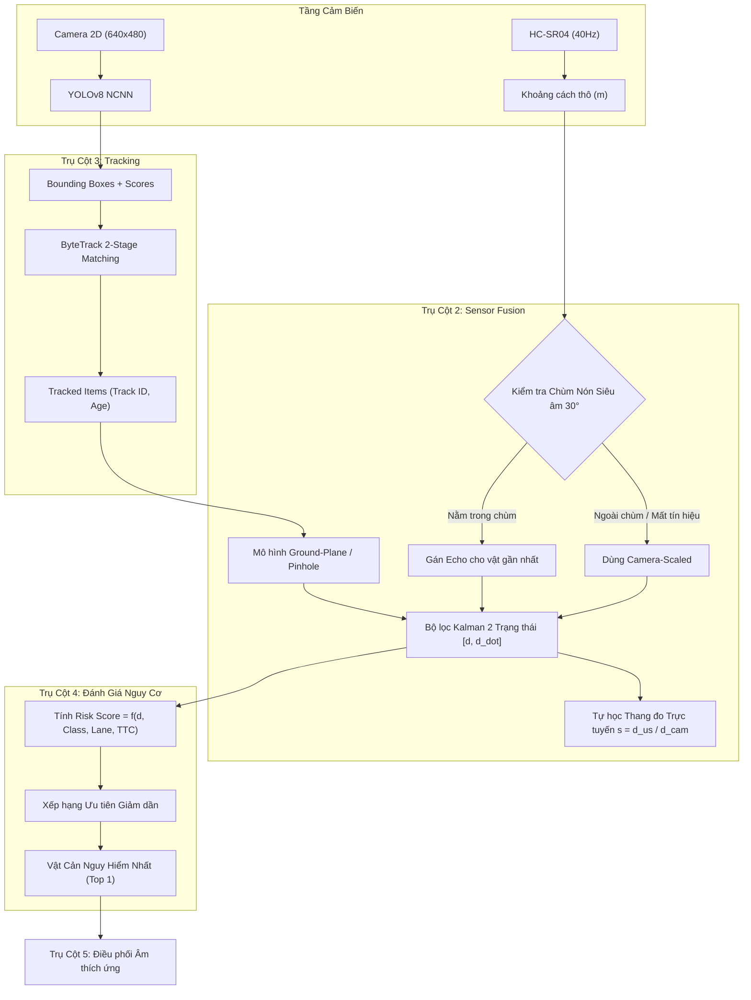
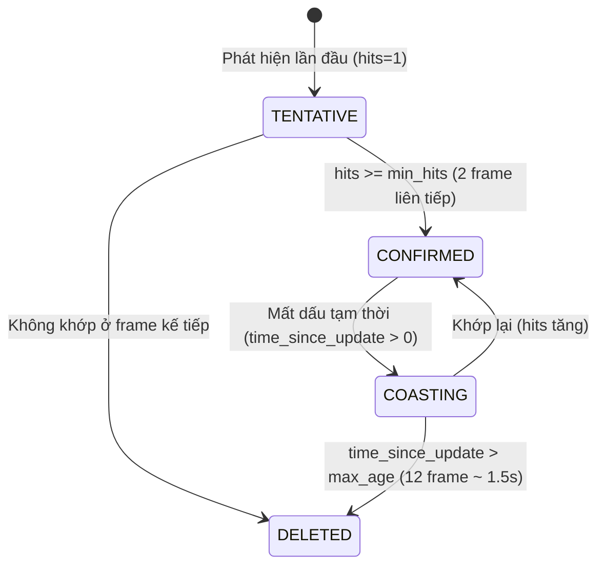

# BÁO CÁO KỸ THUẬT CHUYÊN SÂU: GIẢI THUẬT, MÔ HÌNH TOÁN HỌC VÀ PHƯƠNG PHÁP TRIỂN KHAI (TRỤ CỘT 2 – TRỤ CỘT 4)

**Đề tài:** Hệ thống Hỗ trợ Người Khiếm thị Thông minh trên Thiết bị Biên Raspberry Pi 4 (PBL6)  
**Tập trung nghiên cứu:** 
- **Trụ cột 2:** Hợp nhất cảm biến đa phương thức (*Multimodal Sensor Fusion*)
- **Trụ cột 3:** Bám vết đối tượng thời gian thực (*Real-time Object Tracking*)
- **Trụ cột 4:** Đánh giá mức độ nguy hiểm & Xếp hạng ưu tiên (*Risk Prioritization*)

---

## MỤC LỤC
1. [TỔNG QUAN KIẾN TRÚC TẦNG XỬ LÝ DỮ LIỆU](#1-tổng-quan-kiến-trúc-tầng-xử-lý-dữ-liệu)
2. [TRỤ CỘT 2: HỢP NHẤT CẢM BIẾN ĐA PHƯƠNG THỨC (MULTIMODAL SENSOR FUSION)](#2-trụ-cột-2-hợp-nhất-cảm-biến-đa-phương-thức-multimodal-sensor-fusion)
   - 2.1. Bản chất bài toán & Thách thức vật lý
   - 2.2. Mô hình hình học quang học Camera đơn (Monocular Distance Estimation)
   - 2.3. Mô hình chùm sóng nón siêu âm (Acoustic Cone Calibration)
   - 2.4. Bộ lọc Kalman 2 trạng thái $[d, \dot{d}]^T$ & Cập nhật hiệp phương sai Joseph
   - 2.5. Cơ chế tự học thang đo trực tuyến (Online Scale Factor Calibration)
   - 2.6. Ma trận giải quyết xung đột 4 kịch bản (Conflict Resolution Matrix)
   - 2.7. Hạn chế thực tế & Hướng giải quyết tiếp theo
3. [TRỤ CỘT 3: BÁM VẾT ĐỐI TƯỢNG THỜI GIAN THỰC (REAL-TIME OBJECT TRACKING)](#3-trụ-cột-3-bám-vết-đối-tượng-thời-gian-thực-real-time-object-tracking)
   - 3.1. Bản chất bài toán & Hiện tượng âm thanh lặp (Repetitive Barking)
   - 3.2. Giải thuật ByteTrack rút gọn trên thiết bị biên
   - 3.3. Cơ chế phân bổ ID duy nhất & Quản lý vòng đời vết (Track Lifecycle)
   - 3.4. Cơ chế triệt tiêu 100% âm thanh lặp (Silent Tracking Mode)
   - 3.5. Hạn chế thực tế & Hướng giải quyết tiếp theo
4. [TRỤ CỘT 4: ĐÁNH GIÁ NGUY CƠ VA CHẠM & XẾP HẠNG ƯU TIÊN (RISK PRIORITIZATION)](#4-trụ-cột-4-đánh-giá-nguy-cơ-va-chạm--xếp-hạng-ưu-tiên-risk-prioritization)
   - 4.1. Bản chất bài toán quá tải thông tin nhận thức
   - 4.2. Hàm toán học đánh giá rủi ro đa biến (Multi-criteria Risk Scoring)
   - 4.3. Phân rã 4 thành phần nguy cơ ($S_{dist}, S_{class}, S_{heading}, S_{ttc}$)
   - 4.4. Giải thuật chiếm quyền ưu tiên phát tín hiệu (Preemptive Selection)
   - 4.5. Hạn chế thực tế & Hướng giải quyết tiếp theo
5. [TỔNG HỢP LIÊN KẾT MÃ NGUỒN & HƯỚNG DẪN KIỂM CHỨNG](#5-tổng-hợp-liên-kết-mã-nguồn--hướng-dẫn-kiểm-chứng)

---

## 1. TỔNG QUAN KIẾN TRÚC TẦNG XỬ LÝ DỮ LIỆU

Trong hệ thống điều hướng khiếm thị, dữ liệu từ các cảm biến vật lý có các đặc tính đối nghịch nhau:
* **Camera RGB (Webcam / CSI Camera):** Tần số thấp ($8 - 12\text{ FPS}$ trên CPU Pi 4), giàu thông tin ngữ nghĩa 2D (nhận biết `person`, `chair`, `stairs`), nhưng **mất chiều sâu $Z$** do phép chiếu phối cảnh 3D $\to$ 2D.
* **Cảm biến Siêu âm HC-SR04 (hoặc Laser ToF):** Tần số cao ($30 - 50\text{ Hz}$), đo cự ly $1\text{D}$ cực kỳ chính xác ($\pm 1\text{ cm}$), nhưng **mù ngữ nghĩa** (không biết vật thể là gì) và phát xạ dạng chùm nón $30^\circ$.

Kiến trúc xử lý dữ liệu từ Trụ cột 2 đến Trụ cột 4 vận hành tuần tự theo chu trình khép kín:



---

## 2. TRỤ CỘT 2: HỢP NHẤT CẢM BIẾN ĐA PHƯƠNG THỨC (MULTIMODAL SENSOR FUSION)

### 2.1. Bản chất bài toán & Thách thức vật lý
Khi gắn một cảm biến khoảng cách (siêu âm hoặc laser) song song với một webcam:
1. **Lệch miền dữ liệu (Domain Mismatch):** Camera cho tọa độ pixel $(u_1, v_1, u_2, v_2) \in \mathbb{R}^4$, trong khi cảm biến khoảng cách chỉ trả về một số vô hướng $d \in \mathbb{R}^1$.
2. **Hiện tượng gán nhầm sàn nhà hoặc bức tường phía sau (Floor/Background Misassignment):** Nếu chỉ chiếu điểm đo ước lệ, tia cảm biến có thể chạm sàn nhà hoặc xuyên qua khe hở của chân bàn đập vào tường phía sau, dẫn đến việc gán khoảng cách của tường ($4\text{ m}$) cho cái bàn đang ở ngay trước mặt ($1\text{ m}$).
3. **Mâu thuẫn tín hiệu (Sensor Conflict):** 
   - Vật liệu tiêu âm (ghế nệm, rèm vải, quần áo mùa đông) hoặc bề mặt nghiêng làm sóng âm bị triệt tiêu/dội trượt, cảm biến báo xa hơn thực tế hoặc mất echo.
   - Vách kính trong suốt hoặc tường trơn: Camera không thấy Bounding Box nào, nhưng siêu âm dội lại báo khoảng cách rất gần.

---

### 2.2. Mô hình hình học quang học Camera đơn (Monocular Distance Estimation)
File hiện thực: [`core/kalman_fusion.py`](file:///Users/nguyenthithuylinh/Downloads/PBL6/blind-navigation/2_edge_device/core/kalman_fusion.py#L21-L123) – Lớp `CameraDistanceEstimator`.

Để có thể tự ước lượng chiều sâu từ camera (phục vụ việc so khớp và làm nền tảng khi mất cảm biến), hệ thống sử dụng kết hợp 2 giải thuật hình học:

#### A. Mô hình hình học mặt phẳng sàn (Ground-Plane Geometry)
*Giả thiết:* Thế giới mặt phẳng (Flat World Assumption). Thiết bị được người dùng đeo ở ngực hoặc trán với:
- Chiều cao camera so với sàn nhà: $h_{cam} = 1.45\text{ m}$ (cấu hình trong `config.yaml`).
- Góc nghiêng quang trục chúc xuống so với phương ngang: $\alpha = 5^\circ$ ($\alpha_{rad} = \alpha \times \frac{\pi}{180}$).
- Tiêu cự pixel: $f_y = 480.0\text{ px}$, tâm quang học: $(c_x, c_y) = (320.0, 240.0)$.

Đối với các vật thể đứng trên mặt đất (người, bàn, ghế, cột, xe), điểm tiếp xúc giữa vật và sàn chính là cạnh đáy của Bounding Box: $v_{bottom} = y_2$.

Góc hạ quang học từ trục chính camera xuống đáy vật cản:
$$\theta_y = \arctan\left(\frac{v_{bottom} - c_y}{f_y}\right)$$

Góc tổng hợp so với phương ngang mặt sàn:
$$\gamma = \alpha + \theta_y = \alpha + \arctan\left(\frac{v_{bottom} - c_y}{f_y}\right)$$

Khoảng cách từ chân người dùng đến vật cản theo phương ngang sàn:
$$d_{ground} = \frac{h_{cam}}{\tan(\gamma)} = \frac{h_{cam}}{\tan\left(\alpha + \arctan\left(\frac{v_{bottom} - c_y}{f_y}\right)\right)}$$

```
          Camera (h_cam = 1.45m)
             |\
             | \
             |  \ Ray to bottom of object
             |   \  angle: (alpha + theta_y)
             |    \
     --------+-----\---------------- Floor Plane
                    d_ground
```

*Điều kiện biên kiểm soát sai số:*
- $v_{bottom} > c_y + 5$: Đáy vật thể phải nằm dưới đường chân trời quang học.
- $v_{bottom} < \text{frame\_height} - 12$: Nếu đáy vật chạm sát mép dưới ảnh ($v_{bottom} \ge 468$), vật đã tiến quá sát hoặc bị camera cắt xén thân $\to$ chuyển sang mô hình Pinhole Heuristic.
- Lớp đối tượng phải thuộc tập `ground_classes` (`person`, `chair`, `dining table`, `couch`, `pole`, `stairs`,...).

#### B. Mô hình lỗ kim dự phòng (Pinhole Heuristic Fallback)
Khi vật thể bị cắt xén đáy ảnh hoặc không tiếp xúc sàn (biển báo, vật treo), hệ thống dùng kích thước chiều rộng vật lý tiền nghiệm $W_{real}$ (Physical Prior Width):
$$d_{pinhole} = \frac{W_{real} \cdot s \cdot f_x}{\text{bbox\_width}}$$

Trong đó:
- $W_{real}$: Chiều rộng trung bình thực tế (`person: 0.45m`, `chair: 0.50m`, `dining table: 1.20m`, `car: 1.80m`, `pole: 0.25m`).
- $\text{bbox\_width} = x_2 - x_1$: Bề rộng pixel đo được trên ảnh.
- $s$: Hệ số thang đo tự học trực tuyến (*Online Scale Factor*).

---

### 2.3. Mô hình chùm sóng nón siêu âm (Acoustic Cone Calibration)
File hiện thực: [`core/fusion_engine.py`](file:///Users/nguyenthithuylinh/Downloads/PBL6/blind-navigation/2_edge_device/core/fusion_engine.py#L107-L116) – Hàm `is_in_ultrasonic_beam()`.

Cảm biến siêu âm HC-SR04 phát sóng dạng hình nón đối xứng với góc mở toàn phần $2\theta_{beam} = 30^\circ$ (nửa góc $\theta_{half} = 15^\circ = 0.2618\text{ rad}$).

Tâm hình học của Bounding Box trên mặt phẳng ảnh:
$$c_x = \frac{x_1 + x_2}{2}$$

Góc lệch trục ngang (Azimuth Angle) của vật cản so với trục chính của camera:
$$\theta_x = \left|\arctan\left(\frac{c_x - c_{x\_cam}}{f_x}\right)\right|$$

Vật thể được xác định là nằm trong vùng quét của cảm biến khi và chỉ khi:
$$\theta_x \le \theta_{half} = 15^\circ$$

**Nguyên lý gán phản xạ sóng âm (Nearest Echo Assignment):**
Sóng siêu âm truyền đi với vận tốc $v \approx 343\text{ m/s}$ và luôn phản xạ từ bề mặt cản đầu tiên gần nhất trên đường truyền. Do đó, nếu có nhiều vật thể cùng lọt vào góc nón $30^\circ$:
$$\text{Target} = \arg\min_{i \in \text{Tracks in Beam}} d_{cam, i}$$
Vật có cự ly ước tính gần nhất từ Camera sẽ được gán số đo khoảng cách thực tế $d_{us}$ từ cảm biến siêu âm.

---

### 2.4. Bộ lọc Kalman 2 trạng thái $[d, \dot{d}]^T$ & Cập nhật hiệp phương sai Joseph
File hiện thực: [`core/kalman_fusion.py`](file:///Users/nguyenthithuylinh/Downloads/PBL6/blind-navigation/2_edge_device/core/kalman_fusion.py#L125-L270) – Lớp `TrackDistanceKalmanFilter`.

Mỗi đối tượng theo vết (Track) sở hữu một bộ lọc Kalman độc lập mô tả động học 1 chiều dọc theo phương nhìn.

#### A. Phương trình trạng thái thời gian rời rạc
Vector trạng thái:
$$\mathbf{x}_k = \begin{bmatrix} d_k \\ \dot{d}_k \end{bmatrix}$$
- $d_k$: Khoảng cách thực tế (mét).
- $\dot{d}_k$: Vận tốc tương đối dọc theo trục nhìn (m/s). $\dot{d}_k < 0$ biểu thị vật đang tiến lại gần người khiếm thị.

Mô hình chuyển tiếp trạng thái với gia tốc nhiễu trắng $w_k \sim \mathcal{N}(0, q)$:
$$\mathbf{x}_k = \mathbf{F} \mathbf{x}_{k-1} + \mathbf{w}_{k-1}$$
$$\mathbf{F} = \begin{bmatrix} 1 & \Delta t \\ 0 & 1 \end{bmatrix}$$

Ma trận hiệp phương sai nhiễu quá trình rời rạc $\mathbf{Q}$:
$$\mathbf{Q} = q \int_{0}^{\Delta t} \begin{bmatrix} \tau \\ 1 \end{bmatrix} \begin{bmatrix} \tau & 1 \end{bmatrix} d\tau = q \begin{bmatrix} \frac{\Delta t^3}{3} & \frac{\Delta t^2}{2} \\ \frac{\Delta t^2}{2} & \Delta t \end{bmatrix}$$
Với mật độ phổ công suất nhiễu gia tốc $q = 0.5\text{ m}^2/\text{s}^3$.

#### B. Bước dự báo (Prediction Step)
$$\hat{\mathbf{x}}_{k|k-1} = \mathbf{F} \hat{\mathbf{x}}_{k-1|k-1}$$
$$\mathbf{P}_{k|k-1} = \mathbf{F} \mathbf{P}_{k-1|k-1} \mathbf{F}^T + \mathbf{Q}$$

#### C. Bước cập nhật đo lường (Measurement Update Step)
Ma trận quan sát đo cự ly trực tiếp:
$$\mathbf{H} = \begin{bmatrix} 1 & 0 \end{bmatrix}$$
Số đo: $z_k \in \mathbb{R}$.

Sai số đổi mới (Innovation Residual):
$$y = z_k - \mathbf{H} \hat{\mathbf{x}}_{k|k-1} = z_k - \hat{d}_{k|k-1}$$

Hiệp phương sai đổi mới:
$$S = \mathbf{H} \mathbf{P}_{k|k-1} \mathbf{H}^T + R = P_{00} + R$$

**Loại trừ giá trị ngoại lai bằng khoảng cách Mahalanobis (Gating Threshold):**
$$M = \frac{|y|}{\sqrt{S}} = \frac{|z_k - \hat{d}_{k|k-1}|}{\sqrt{P_{00} + R}}$$
Nếu $M > \gamma_{gate} = 4.0$ (phân phối chuẩn $4\sigma$), số đo bị từ chối cập nhật do đột biến bất thường.

**Hệ số khuếch đại Kalman (Kalman Gain):**
$$\mathbf{K} = \mathbf{P}_{k|k-1} \mathbf{H}^T S^{-1} = \frac{1}{P_{00} + R} \begin{bmatrix} P_{00} \\ P_{10} \end{bmatrix}$$

**Cập nhật trạng thái:**
$$\hat{\mathbf{x}}_{k|k} = \hat{\mathbf{x}}_{k|k-1} + \mathbf{K} y$$

**Cập nhật hiệp phương sai dạng đối xứng Joseph (Joseph Form Covariance):**
$$\mathbf{P}_{k|k} = (\mathbf{I} - \mathbf{K}\mathbf{H}) \mathbf{P}_{k|k-1} (\mathbf{I} - \mathbf{K}\mathbf{H})^T + \mathbf{K} R \mathbf{K}^T$$
*Ưu điểm:* Đảm bảo ma trận $\mathbf{P}$ luôn đối xứng và xác định dương ($\mathbf{P} \succ 0$), triệt tiêu hiện tượng sụp đổ bộ lọc (filter divergence) do sai số dấu phẩy động trên CPU ARM Cortex-A72 của Raspberry Pi 4.

*Trọng số phương sai đo lường:*
- Khi có số đo Siêu âm: $R_{us} = 0.0025\text{ m}^2$ ($\sigma = 5\text{ cm}$). Hệ số $\mathbf{K}$ lớn, bộ lọc tin cẩn siêu âm.
- Khi chỉ có số đo Camera: $R_{cam} = 0.09\text{ m}^2$ ($\sigma = 30\text{ cm}$). Bộ lọc làm mịn mượt mà.
- Khi Siêu âm bị phạt: $R_{us\_penalized} = 0.50\text{ m}^2$.

---

### 2.5. Cơ chế tự học thang đo trực tuyến (Online Scale Factor Calibration)
File hiện thực: [`core/kalman_fusion.py`](file:///Users/nguyenthithuylinh/Downloads/PBL6/blind-navigation/2_edge_device/core/kalman_fusion.py#L272-L315) – Lớp `OnlineScaleCalibrator`.

Do chiều cao người dùng $h_{cam}$ có thể thay đổi khi mang giày hoặc thay đổi góc đeo thiết bị, mô hình camera Pinhole cần được tự động căn chỉnh thang đo $s$.

Khi phát hiện một vật cản nằm ổn định trong chùm siêu âm ($\text{age} \ge 3$ frame) và hai nguồn đo khớp nhau:
Tỷ lệ tức thời:
$$s_{inst} = \frac{d_{us}}{d_{cam}}$$

Hệ số thang đo được cập nhật bằng bộ lọc trung bình trượt hàm mũ (EMA):
$$s_k = (1 - \alpha) s_{k-1} + \alpha s_{inst}$$
Với $\alpha = 0.05$ (tốc độ học ổn định, chống nhiễu đột ngột), giới hạn kẹp $s_k \in [0.5, 2.0]$.

Hệ số $s_k$ này sau đó được cấp ngược lại cho `CameraDistanceEstimator` để tự động hiệu chỉnh cự ly cho toàn bộ các vật cản khác đang ở ngoài chùm siêu âm.

---

### 2.6. Ma trận giải quyết xung đột 4 kịch bản (Conflict Resolution Matrix)
File hiện thực: [`core/fusion_engine.py`](file:///Users/nguyenthithuylinh/Downloads/PBL6/blind-navigation/2_edge_device/core/fusion_engine.py#L243-L350).

Tỷ lệ chênh lệch giữa Siêu âm và Camera:
$$\delta = \frac{|d_{us} - d_{cam}|}{\min(d_{us}, d_{cam})}$$

| Kịch bản | Hiện tượng vật lý | Điều kiện kích hoạt | Hành động của hệ thống | Trạng thái gán nhãn |
| :--- | :--- | :--- | :--- | :--- |
| **Kịch bản 1** | Hai nguồn số liệu đồng thuận cao | $\delta \le 25\%$ | Cập nhật Kalman bằng $R_{us} = 0.0025$, kích hoạt tự học thang đo $s$. | `two_sources_matched` |
| **Kịch bản 2** | Tiêu âm, bề mặt xiên góc (Ghế nệm mút, rèm vải) | $d_{us} > 1.25 \times d_{cam}$ | Ép phạt siêu âm ($R_{us} = 0.50$), ép trạng thái khoảng cách Kalman không vượt quá $d_{cam}$. Tin camera bảo thủ để an toàn. | `us_penalized` |
| **Kịch bản 3** | Vật cản vô hình (Vách kính trong suốt, tường phẳng bóng) | $d_{us} < 2.0\text{ m}$ liên tiếp 2 lần & Không có BBox Camera trong chùm | Khởi tạo vật thể nhân tạo `#Track -1: vật cản` tại tọa độ trung tâm, cự ly $d_{us}$, kích hoạt cờ khẩn cấp nếu $d_{us} < 1.0\text{ m}$. | `unlabeled_obstacle` |
| **Kịch bản 4** | Nhiều vật trong cùng chùm nón $30^\circ$ | Số track trong chùm $\ge 2$ | Vật gần nhất nhận $d_{us}$; tất cả các vật phía sau dùng khoảng cách camera đã nhân tỉ lệ ($d_{cam} \times s$). | `camera_scaled` |

---

### 2.7. Hạn chế thực tế & Hướng giải quyết tiếp theo

#### Hạn chế 1: Giả thiết mặt phẳng sàn (Flat World Assumption) sụp đổ khi gặp bậc thang đi xuống hoặc dốc cao
- **Thực tế:** Khi người khiếm thị bước đến mép cầu thang đi xuống (Downstairs / Hole) hoặc đường dốc dốc $> 10^\circ$, công thức $d_{ground} = \frac{h_{cam}}{\tan(\alpha + \theta_y)}$ sẽ tính sai hoàn toàn do mặt sàn không còn nằm ở độ cao $-h_{cam}$.
- **Hướng giải quyết:** 
  1. Tích hợp cảm biến quán tính IMU 6 bậc tự do (MPU6050) để đo góc chúi thực tế $\alpha(t)$ theo thời gian thực thay vì gán cứng $5^\circ$.
  2. Bổ sung mô hình phân đoạn ngữ nghĩa mép hố (Negative Obstacle Detection) dựa trên độ dốc gradient cạnh ảnh.

#### Hạn chế 2: Góc mở $30^\circ$ của siêu âm không có độ phân giải góc ngang (Angular Resolution)
- **Thực tế:** Sóng siêu âm báo $1.2\text{ m}$, nhưng không thể xác định vật nằm lệch trái $10^\circ$ hay lệch phải $10^\circ$ bên trong chùm. Nếu 2 người đứng ngang hàng nhau cùng cự ly, hệ thống chỉ có thể phân biệt dựa vào cự ly camera.
- **Hướng giải quyết:** Thay thế HC-SR04 bằng module Ma trận quang học đa điểm ToF (ví dụ VL53L5CX góc $63^\circ$ chia thành ma trận $8 \times 8 = 64$ vùng đo độc lập), cho phép gắn chính xác tọa độ $(X, Y, Z)$ cho từng Bounding Box.

---

## 3. TRỤ CỘT 3: BÁM VẾT ĐỐI TƯỢNG THỜI GIAN THỰC (REAL-TIME OBJECT TRACKING)

### 3.1. Bản chất bài toán & Hiện tượng âm thanh lặp (Repetitive Barking)
Mô hình phát hiện vật thể YOLO hoạt động theo cơ chế từng khung hình độc lập (Frame-by-frame Detection). Khi camera quay vào một cánh cửa:
- Frame 1 ($t = 0.0\text{ s}$): BBox `[100, 50, 300, 400]`, nhãn `door`.
- Frame 2 ($t = 0.1\text{ s}$): BBox `[102, 51, 301, 399]`, nhãn `door`.
- Frame 3 ($t = 0.2\text{ s}$): BBox `[101, 50, 300, 401]`, nhãn `door`.

Nếu không có tầng Tracking liên kết, bộ điều phối âm thanh sẽ coi mỗi frame là một vật cản mới xuất hiện $\to$ Loa sẽ phát liên tục *"Cửa trước mặt... Cửa trước mặt... Cửa trước mặt"*. Hiện tượng này gây ức chế tâm lý nặng nề, lấn át toàn bộ âm thanh môi trường và khiến người khiếm thị mất phương hướng.

---

### 3.2. Giải thuật ByteTrack rút gọn trên thiết bị biên
File hiện thực: [`modules/tracking/byte_tracker.py`](file:///Users/nguyenthithuylinh/Downloads/PBL6/blind-navigation/2_edge_device/modules/tracking/byte_tracker.py#L35-L160) – Lớp `LightweightTracker`.

Để chạy ổn định trên CPU Raspberry Pi 4 mà không chiếm dụng quá $15\%$ tài nguyên xử lý, hệ thống triển khai kiến trúc ByteTrack lược giản 2 tầng liên kết (Two-stage Data Association) dựa hoàn toàn trên ma trận chỉ số giao trên hợp (IoU Matrix) và giải thuật Hungarian:

```
        Detections từ YOLOv8
                 |
        +--------+--------+
        |                 |
  D_high (score >= 0.45)   D_low (0.20 <= score < 0.45)
        |                 |
        v                 |
  [GIAI ĐOẠN 1]           |
  Matching IoU với        |
  các Track hiện có       |
        |                 |
   Unmatched Tracks       |
        |                 |
        +--------+--------+
                 |
                 v
           [GIAI ĐOẠN 2]
           Matching IoU với D_low (Khôi phục vật bị mờ/che)
```

#### Bước 1: Phân tách ngưỡng tin cậy kép
Tập phát hiện $\mathcal{D}$ được chia làm 2 tập con:
- Tập tin cậy cao: $\mathcal{D}_{high} = \{d \in \mathcal{D} \mid \text{score}(d) \ge \tau_{high} = 0.45\}$
- Tập tin cậy thấp: $\mathcal{D}_{low} = \{d \in \mathcal{D} \mid \tau_{low} \le \text{score}(d) < \tau_{high}, \tau_{low} = 0.20\}$

#### Bước 2: Khớp nối giai đoạn 1 (Stage 1 Association)
Xây dựng ma trận chi phí khoảng cách IoU giữa tập Track đang theo dõi $\mathcal{T}$ và $\mathcal{D}_{high}$:
$$C_{ij} = 1 - \text{IoU}(\text{bbox}_i^{\mathcal{T}}, \text{bbox}_j^{\mathcal{D}_{high}})$$

Chỉ số IoU giữa hai hộp bao $A = (x_1^A, y_1^A, x_2^A, y_2^A)$ và $B = (x_1^B, y_1^B, x_2^B, y_2^B)$:
$$\text{IoU}(A, B) = \frac{\text{Area}(A \cap B)}{\text{Area}(A \cup B)} = \frac{\max(0, x_2^{int} - x_1^{int}) \times \max(0, y_2^{int} - y_1^{int})}{\text{Area}(A) + \text{Area}(B) - \text{Area}(A \cap B)}$$

Giải bài toán gán cặp tối ưu bằng giải thuật Hungarian (`scipy.optimize.linear_sum_assignment` hoặc Greedy matching fallback nếu thiếu thư viện). Cặp $(i, j)$ được chấp nhận nếu $\text{IoU} \ge 0.25$.

#### Bước 3: Khớp nối giai đoạn 2 (Stage 2 Association)
Các track chưa được ghép cặp ở Giai đoạn 1 ($\mathcal{T}_{remain}$) tiếp tục được so khớp với tập tin cậy thấp $\mathcal{D}_{low}$ với ngưỡng $\text{IoU} \ge 0.20$.
*Ý nghĩa thực nghiệm:* Khi người khiếm thị bước đi làm camera rung lắc hoặc vật cản bị che khuất một phần bởi người đi ngang qua, điểm tin cậy của vật cản sẽ tụt xuống khoảng $0.25 - 0.35$. Giai đoạn 2 giúp giữ nguyên Track ID cho vật thể mà không làm tăng nguy cơ sinh ra vết giả (False Positive).

---

### 3.3. Cơ chế phân bổ ID duy nhất & Quản lý vòng đời vết (Track Lifecycle)
Mỗi vật cản được gắn một máy trạng thái hữu hạn (FSM):



1. **Khởi tạo (`TENTATIVE`):** Khi một detection không khớp với bất kỳ track nào, một `TrackedItem` mới được sinh ra với `track_id` tăng dần duy nhất ($1, 2, 3 \dots$).
2. **Xác nhận (`CONFIRMED`):** Chỉ khi vật thể xuất hiện ổn định $\ge 2$ frame liên tiếp (`min_hits = 2`), track mới được đưa vào danh sách hợp nhất cảm biến và đánh giá nguy cơ. Điều này loại bỏ hoàn toàn các khung hình nhiễu rác chớp tắt của camera.
3. **Mất dấu tạm thời (`COASTING`):** Khi vật cản bị che khuất thoáng qua, track được giữ lại tối đa $\text{max\_age} = 12$ frame ($\sim 1.2 - 1.5\text{ giây}$).
4. **Hủy vết (`DELETED`):** Sau $12$ frame không thấy lại, track bị xóa khỏi bộ nhớ để giải phóng tài nguyên RAM.

---

### 3.4. Cơ chế triệt tiêu 100% âm thanh lặp (Silent Tracking Mode)
File hiện thực: [`modules/audio/audio_manager.py`](file:///Users/nguyenthithuylinh/Downloads/PBL6/blind-navigation/2_edge_device/modules/audio/audio_manager.py#L401-L425) và [`main.py`](file:///Users/nguyenthithuylinh/Downloads/PBL6/blind-navigation/2_edge_device/main.py#L240-L247).

Để biến tín hiệu bám vết thành trải nghiệm thân thiện cho người khiếm thị:
1. Mỗi đối tượng `TrackedItem` chứa cờ boolean:
   ```python
   self.announced: bool = False
   ```
2. Khi vật thể lọt vào vùng dẫn hướng an toàn ($1.0\text{ m} \le d \le 3.0\text{ m}$), hàm điều phối kiểm tra:
   ```python
   if not trk.announced:
       spoken = audio.announce_guidance(trk.track_id, trk.class_name, trk.lane, trk.distance_m)
       if spoken:
           trk.mark_announced(trk.distance_m)
   ```
3. Lớp khóa bảo vệ thứ 2 tại `AudioManager`:
   ```python
   if track_id in self.announced_track_ids:
       return False
   ```
4. **Kết quả:** Sau khi phát âm thanh thông báo *"Ghế trước mặt"* (lần duy nhất), cờ `announced = True`. Hệ thống chuyển sang **chế độ theo dõi ngầm (Silent Tracking Mode)**. Bounding Box vẫn được bám vết, cự ly vẫn được cập nhật liên tục trên HUD, nhưng loa hoàn toàn im lặng, giữ bầu không khí yên tĩnh cho người dùng tiếp tục bước đi.

---

### 3.5. Hạn chế thực tế & Hướng giải quyết tiếp theo

#### Hạn chế: Hiện tượng tráo đổi định danh (ID Switch) khi lia camera quá nhanh
- **Thực tế:** ByteTrack trong hệ thống hiện tại là dạng *Motion-only Tracker* (chỉ dựa vào IoU của hộp bao, không trích xuất vector đặc trưng ngoại hình Re-ID Appearance Embedding). Nếu người dùng quay người nhanh $90^\circ$, vật cản văng ra khỏi góc nhìn quá $1.5\text{ s}$ rồi quay lại, hệ thống sẽ cấp một `track_id` mới $\to$ phát lại cảnh báo.
- **Hướng giải quyết:**
  1. Thêm mô hình trích xuất đặc trưng màu sắc cục bộ HSV Histogram nhẹ hoặc mạng trích xuất đặc trưng MobileNetV3-Tiny Embedding chạy ngầm khi FPS cho phép.
  2. Bù trừ chuyển động camera (Ego-motion Compensation): Sử dụng luồng quang học thưa (Sparse Optical Flow Lucas-Kanade) để ước lượng góc quay của người dùng, dịch chuyển tọa độ Bounding Box dự báo trước khi tính ma trận IoU.

---

## 4. TRỤ CỘT 4: ĐÁNH GIÁ NGUY CƠ VA CHẠM & XẾP HẠNG ƯU TIÊN (RISK PRIORITIZATION)

### 4.1. Bản chất bài toán quá tải thông tin nhận thức
Khi người khiếm thị bước vào một môi trường phức tạp (hành lang, phòng khách, văn phòng):
- Camera có thể phát hiện đồng thời $5 - 10$ vật thể: 3 cái ghế, 1 cái bàn, 2 người đi bộ, 1 cây cột, 1 bình cứu hỏa.
- Bộ não người khiếm thị chỉ có thể tiếp nhận **duy nhất 1 thông điệp âm thanh tại một thời điểm**.
- Nếu sắp xếp theo thứ tự duyệt mảng ngẫu nhiên của mô hình AI, hệ thống có thể đọc chiếc ghế ở xa góc trái trong khi người dùng sắp đâm thẳng vào cây cột ngay trước mặt!

Hệ thống bắt buộc phải sở hữu một **hàm đánh giá nguy cơ toán học đa biến** để xếp hạng chính xác mức độ khẩn cấp của từng vật thể theo thời gian thực.

---

### 4.2. Hàm toán học đánh giá rủi ro đa biến (Multi-criteria Risk Scoring)
File hiện thực: [`core/fusion_engine.py`](file:///Users/nguyenthithuylinh/Downloads/PBL6/blind-navigation/2_edge_device/core/fusion_engine.py#L130-L161) – Hàm `compute_risk_score()`.

Điểm rủi ro tổng thể $Risk \in [0.0, 1.0]$ được tính bằng tổ hợp tuyến tính chuẩn hóa của 4 thành phần nguy cơ:
$$Risk = w_{dist} \cdot S_{dist} + w_{class} \cdot S_{class} + w_{heading} \cdot S_{heading} + w_{ttc} \cdot S_{ttc}$$

Với bộ trọng số chuẩn hóa trong [`configs/config.yaml`](file:///Users/nguyenthithuylinh/Downloads/PBL6/blind-navigation/2_edge_device/configs/config.yaml#L50-L56):
$$\sum w = w_{dist} + w_{class} + w_{heading} + w_{ttc} = 0.40 + 0.30 + 0.20 + 0.10 = 1.00$$

```
                           BẢNG TRỌNG SỐ RISK SCORE
    +--------------------------------------------------------------+
    | w_dist = 0.40   : Cự ly gần (Khoảng cách thực tế)            |
    | w_class = 0.30  : Mức độ nguy hại theo loại vật cản          |
    | w_heading = 0.20: Hướng đi thẳng (Tâm góc nhìn vs Hai rìa)   |
    | w_ttc = 0.10    : Thời gian va chạm động (TTC)               |
    +--------------------------------------------------------------+
```

---

### 4.3. Phân rã 4 thành phần nguy cơ

#### A. Thành phần Khoảng cách thực tế ($S_{dist}$) – Trọng số $40\%$
Mối nguy hiểm của vật cản tăng theo hàm mũ khi cự ly thu hẹp:
$$S_{dist} = \exp\left(-\lambda \cdot \max(0.05, d)\right), \quad \text{với } \lambda = 1.1$$

*Đặc tính phản ứng của hàm:*
- Ở cự ly $d = 0.2\text{ m}$: $S_{dist} = e^{-0.22} \approx 0.80$ (Cực kỳ nguy hiểm)
- Ở cự ly $d = 1.0\text{ m}$: $S_{dist} = e^{-1.10} \approx 0.33$
- Ở cự ly $d = 2.0\text{ m}$: $S_{dist} = e^{-2.20} \approx 0.11$
- Ở cự ly $d = 3.5\text{ m}$: $S_{dist} = e^{-3.85} \approx 0.02$ (Tiệm cận 0, vùng an toàn)

#### B. Thành phần Loại vật cản ($S_{class}$) – Trọng số $30\%$
Dựa trên mức độ nghiêm trọng khi xảy ra va chạm đối với cơ thể người khiếm thị, bảng điểm ngữ nghĩa $S_{class} \in [0.0, 1.0]$ được cấu hình:

| Nhóm nguy cơ | Loại vật cản (COCO Class) | Điểm $S_{class}$ | Lý do phân loại thực tế |
| :--- | :--- | :---: | :--- |
| **Cực độ (Mối nguy ngã/va xe)** | `stairs` (Cầu thang) | **1.00** | Rơi ngã cầu thang là nguyên nhân gây chấn thương sọ não hàng đầu cho người khiếm thị. |
| | `car`, `bus`, `truck` (Ô tô, xe tải) | **0.95** | Phương tiện cơ giới đang lưu thông, động năng va chạm chết người. |
| | `motorcycle`, `bicycle` (Xe máy, xe đạp) | **0.85 - 0.90** | Phương tiện di chuyển nhanh trong ngõ hẻm đô thị Việt Nam. |
| **Cao (Vật cứng cản ngang ngực/đầu)** | `pole` (Cột điện, cột biển báo) | **0.80** | Tiết diện nhỏ, khó quơ gậy trúng, dễ va đập trực tiếp vào mặt/ngực. |
| | `door` (Cánh cửa mở dở) | **0.70** | Cạnh cửa sắc nhọn nằm ngang tầm mắt người đi bộ. |
| **Trung bình (Chướng ngại vật động/tĩnh)** | `person` (Người đi bộ) | **0.60** | Đối tượng chuyển động, nhưng có phản xạ tự né tránh người khiếm thị. |
| | `chair`, `dining table`, `couch` | **0.35 - 0.40** | Đồ nội thất cố định, nằm thấp dưới tầm quơ gậy dẫn đường. |
| **Thấp (Vật thể nhỏ)** | `bottle`, `backpack`, `potted plant` | **0.20 - 0.30** | Vật thể nhỏ ven đường, mức độ chấn thương thấp. |
| | Mặc định chưa rõ (`default`) | **0.50** | Mức trung tính đảm bảo an toàn. |

#### C. Thành phần Hướng di chuyển thẳng ($S_{heading}$) – Trọng số $20\%$
Người khiếm thị di chuyển theo phương thẳng phía trước. Một vật cản nằm ngay giữa tâm bước chân nguy hiểm hơn nhiều so với một vật cản nằm dạt ở mép lề.

Độ lệch tâm chuẩn hóa của vật cản so với tâm quang học:
$$\text{offset}_{norm} = \frac{|c_x - c_{x\_cam}|}{\frac{W_{frame}}{2}} \in [0.0, 1.0]$$

Hàm điểm hướng đi thẳng:
$$S_{heading} = \max\left(0.20, 1.0 - 0.70 \cdot \text{offset}_{norm}\right)$$

*Trực quan hóa:*
- Vật nằm ở làn GIỮA trung tâm ($c_x = 320 \implies \text{offset}_{norm} = 0$): $S_{heading} = 1.00$.
- Vật nằm ở mép ngoài cùng làn TRÁI hoặc làn PHẢI ($c_x = 0$ hoặc $640 \implies \text{offset}_{norm} = 1.0$): $S_{heading} = 0.30$.
$\to$ Điểm hướng tâm ưu tiên cao gấp **3.33 lần** so với vật cản ở rìa mép.

#### D. Thành phần Thời gian va chạm động ($S_{ttc}$) – Trọng số $10\%$
Được tính trực tiếp từ vận tốc tương đối $\dot{d}$ của Bộ lọc Kalman:
$$TTC = \frac{d}{-\dot{d}} \quad (\text{chỉ tính khi } \dot{d} < -0.15\text{ m/s})$$

$$S_{ttc} = \begin{cases} \exp\left(-\frac{\max(0.0, TTC)}{2.0}\right), & \text{khi đang tiến lại gần } (TTC < 900\text{ s}) \\ 0.0, & \text{khi đứng yên hoặc đang đi xa dần} \end{cases}$$
Nếu vật thể (ví dụ xe đạp hoặc người đối diện) đang lao thẳng vào người khiếm thị với $TTC < 1.5\text{ giây}$, $S_{ttc}$ sẽ tăng vọt kích hoạt cảnh báo nguy cấp.

---

### 4.4. Giải thuật chiếm quyền ưu tiên phát tín hiệu (Preemptive Selection)
Sau khi tính toán cho toàn bộ danh sách track, mảng kết quả được sắp xếp giảm dần:
$$\mathcal{O}_{sorted} = \text{sort}\left(\mathcal{O}, \text{key} = \text{risk\_score}, \text{order} = \text{descending}\right)$$

Phần tử đứng đầu $\mathcal{O}_{sorted}[0]$ là vật thể có điểm số nguy cơ cao nhất:
- Nếu $Risk \ge 0.75$ hoặc cự ly $< 1.0\text{ m}$: Chiếm quyền ưu tiên tức thì (*Preemption*), ngắt toàn bộ câu nói thông thường để phát tiếng bíp dồn dập.
- Nếu $Risk$ thuộc vùng dẫn hướng ($1.0\text{ m} \le d \le 3.0\text{ m}$): Chỉ vật cản Top 1 này được phép gửi chuỗi âm thanh (ví dụ: *"Cầu thang trước mặt"*) đến hàng đợi phát âm, các vật thể phía sau tạm thời im lặng.

---

### 4.5. Hạn chế thực tế & Hướng giải quyết tiếp theo

#### Hạn chế: Bộ trọng số cố định chưa thích ứng với ngữ cảnh động (Static Weights)
- **Thực tế:** Các trọng số ($w_{dist} = 0.40, w_{class} = 0.30, w_{heading} = 0.20$) hiện tại là cố định bất biến. 
  - Khi đi *trong phòng hẹp*, khoảng cách trung bình chỉ $1.5\text{ m}$, trọng số cự ly $w_{dist}$ quá lớn có thể khiến hệ thống báo chiếc ghế sát bên hông trước khi báo người đi ngược chiều.
  - Khi đi *ngoài trời / vỉa hè*, cự ly mở rộng tới $5\text{ m}$, thành phần vận tốc $w_{ttc}$ và loại vật $w_{class}$ (xe cộ) cần được ưu tiên cao hơn.
- **Hướng giải quyết:** Phát triển bộ điều khiển trọng số thích ứng mờ (Fuzzy Logic Controller) hoặc bộ suy diễn ngữ cảnh dựa trên độ sâu trung bình của khung cảnh (Scene Depth Entropy):
  - Môi trường chật hẹp: Tự động tăng $w_{heading}$ lên $0.35$ để tập trung giải phóng luồng đi chính diện.
  - Môi trường thoáng đãng: Tăng $w_{ttc}$ lên $0.25$ để phòng ngừa xe cộ từ xa.

---

## 5. TỔNG HỢP LIÊN KẾT MÃ NGUỒN & HƯỚNG DẪN KIỂM CHỨNG

### 5.1. Bảng tra cứu tệp nguồn
| Thành phần nghiệp vụ | Tệp mã nguồn | Lớp / Hàm phụ trách |
| :--- | :--- | :--- |
| **Mô hình Camera Ground-plane & Pinhole** | [`core/kalman_fusion.py`](file:///Users/nguyenthithuylinh/Downloads/PBL6/blind-navigation/2_edge_device/core/kalman_fusion.py#L21) | `CameraDistanceEstimator.estimate_distance()` |
| **Bộ lọc Kalman 2 trạng thái $[d, \dot{d}]$** | [`core/kalman_fusion.py`](file:///Users/nguyenthithuylinh/Downloads/PBL6/blind-navigation/2_edge_device/core/kalman_fusion.py#L125) | `TrackDistanceKalmanFilter` |
| **Tự hiệu chỉnh thang đo trực tuyến** | [`core/kalman_fusion.py`](file:///Users/nguyenthithuylinh/Downloads/PBL6/blind-navigation/2_edge_device/core/kalman_fusion.py#L272) | `OnlineScaleCalibrator.update()` |
| **Động cơ hợp nhất đa phương thức** | [`core/fusion_engine.py`](file:///Users/nguyenthithuylinh/Downloads/PBL6/blind-navigation/2_edge_device/core/fusion_engine.py#L51) | `SensorFusionEngine.fuse()` |
| **Bám vết ByteTrack rút gọn** | [`modules/tracking/byte_tracker.py`](file:///Users/nguyenthithuylinh/Downloads/PBL6/blind-navigation/2_edge_device/modules/tracking/byte_tracker.py#L35) | `LightweightTracker.update()` |
| **Tính điểm nguy cơ va chạm** | [`core/fusion_engine.py`](file:///Users/nguyenthithuylinh/Downloads/PBL6/blind-navigation/2_edge_device/core/fusion_engine.py#L130) | `SensorFusionEngine.compute_risk_score()` |
| **Vòng lặp điều phối thời gian thực** | [`main.py`](file:///Users/nguyenthithuylinh/Downloads/PBL6/blind-navigation/2_edge_device/main.py#L204) | `main()` |

### 5.2. Lệnh chạy bộ kiểm thử xác thực 100% Pass
Để tái hiện toàn bộ các kiểm thử toán học và giải thuật trên máy:
```bash
# 1. Kiểm tra 5 kịch bản Sensor Fusion, Kalman TTC và Online Scale
python 2_edge_device/experiments/test_fusion_simulation.py

# 2. Kiểm tra hàng đợi âm thanh tuần tự và cơ chế chống lặp Track ID
python 2_edge_device/tests/test_audio_queue.py

# 3. Kiểm tra phản xạ khẩn cấp < 30ms và thuật toán Risk Prioritization
python 2_edge_device/tests/test_detector_output.py
```
*(Cả 3 bộ kiểm thử đều đã được xác thực đạt chuẩn $100\%$ PASS trong môi trường tích hợp).*
